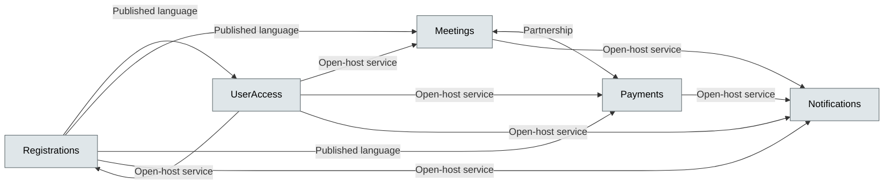
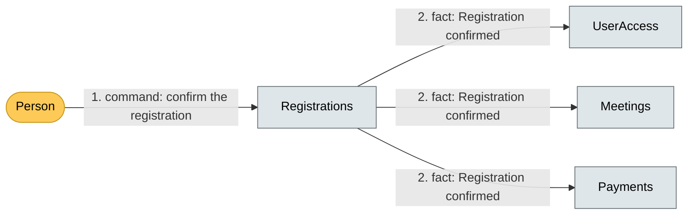
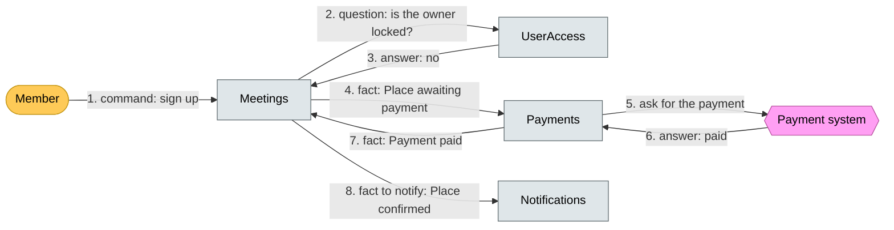
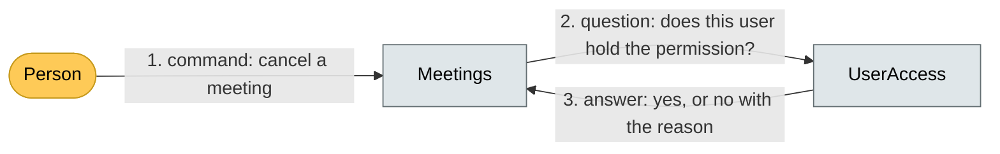
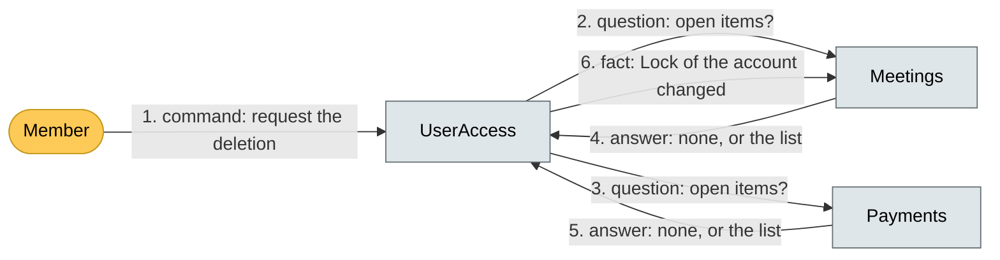
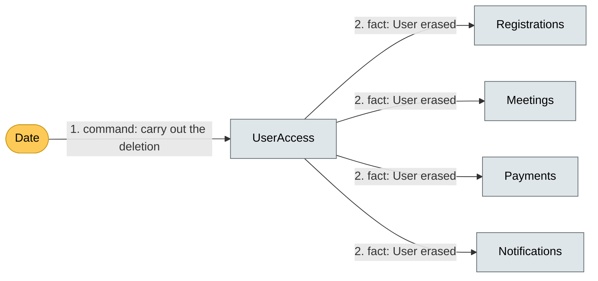

# Between modules

The five modules of [modules and layers](modules-and-layers.md) hold their own data and own rules. They still have to work together: a confirmed registration creates a member, a paid fee confirms a place, a deletion reaches every context. This page says **what goes from one module to another, in which form, and with which guarantees**. It answers D1, D6 and D8 of [what the domain demands](drivers.md).

Concepts used: [event-driven architecture](concepts/event-driven-architecture.md) and [modular monolith](concepts/modular-monolith.md). The tools come from the [DDD Starter Modelling Process](https://ddd-crew.github.io/ddd-starter-modelling-process/): a [context map](https://github.com/ddd-crew/context-mapping) for the relations, [domain message flow modelling](https://github.com/ddd-crew/domain-message-flow-modelling) for the scenarios, and the inbound and outbound sections of the [bounded context canvas](https://github.com/ddd-crew/bounded-context-canvas) for the lists of messages.

## Two kinds of message

A module never reads the data of another, nor calls its inside. It sends or answers **messages**, each of one of two kinds:

| | Fact | Question |
| :-- | :-- | :-- |
| Says | Something happened in the module, in the past tense | Is this true, or what is this, right now? |
| Goes | From the module where it happened, to every module that needs to know | From the module that needs the answer, to the module that owns it |
| Moment | Later: the receiver reacts in its own time | At once: the sender waits for the answer |
| Changes the receiver | Yes, through a command of the receiver (see [use cases](use-cases.md#where-a-use-case-comes-from)) | Never |
| Owner of its words | The module where it happened | The module that answers |
| Fits | "Never lost, never twice" and "without noticeable delay" | "Exact at the moment of an action" |

A **fact** is the default, and the way the modules stay independent: the sender does not know who reacts, nor whether anyone does. A **question** exists for the one thing a fact cannot give: an answer that is right *when an action is decided*, not a moment before. It is allowed only for that, and only to read.

There is no third kind. A module cannot order another to change: it states a fact, and the other module decides what it does with it, with its own rules.

## The Contract has two parts

Everything a module says to the others is in its **Contract**, in the words of its own glossary. The Contract is split in two, so that one sees at a glance what a module makes known and what it lets others ask:

| Part | Holds | Used by |
| :-- | :-- | :-- |
| **Facts** | The facts the module makes known, each a **data type** with its data. The owner produces them and implements nothing | The modules that need to know: each has a handler in its Ui that turns the fact into a command |
| **Questions** | The questions the module answers, each a method of an **interface**, with the type of its answer. The owner implements the interface, in its Application | The modules that need an answer at the moment: each asks through a port of its own, in its own words, and an adapter of its Infrastructure calls the interface |

The Contract carries no rule and depends on nothing but the shared kernel: the implementation of a question stays in the module that owns it. It is the published language of the context: stable, because others rely on it, and changed with care.

A module that receives a message **translates it into its own model** before using it. A member in Meetings, a payer in Payments and a user in UserAccess are born from the same confirmed registration, and each keeps what it needs under its own name.

## Who relates to whom

The relations of the five contexts, as patterns of a context map. An arrow goes from the **upstream** context, which others rely on, to the **downstream** one.

*Each box is a context. The label is the pattern of the relation. For Notifications, the contexts hand it facts in the language it publishes: it knows none of them.*

| Relation | Pattern | Why |
| :-- | :-- | :-- |
| Registrations to UserAccess, Meetings, Payments | Published language | One fact, a confirmed registration, that each context translates into its own model |
| UserAccess to every other context | Open-host service | Permissions, the lock, and the deletion of an account are served the same way to all, whatever the context. UserAccess also tells Registrations of the deletion |
| Meetings and Payments | Partnership | A place to pay, a payment that is paid, a payout account and a fee yet to come: each needs the other, and the two evolve together |
| Registrations, UserAccess, Meetings and Payments to Notifications | Open-host service | Notifications publishes one language to receive what to notify, and knows no context. It is a context like the others, with its own rules ([Notifications](../domain/notifications/description.md)) |

No context is a **conformist**: each one translates what it receives into its own model, in the handler of the fact or in the adapter of the question, and nobody adopts the model of another.

## What each module sends and receives

The tables "What X needs from other contexts" of the domain pages, one for [Meetings](../domain/meetings/description.md#what-meetings-needs-from-other-contexts), [Payments](../domain/payments/description.md#what-payments-needs-from-other-contexts) and [Notifications](../domain/notifications/description.md#what-notifications-needs-from-other-contexts), give each need its exactness and its freshness. This table settles the kind of message for each, with the criterion in the last column. For a fact, "From, to" goes from the sender to the receivers. For a question, it names the module that **owns** the answer first, then the module that asks.

| Need | From, to | Kind | Carries | Why this kind |
| :-- | :-- | :-- | :-- | :-- |
| A registration was confirmed, with its role | Registrations to UserAccess, Meetings, Payments | Fact | State | Never lost, never twice. A short delay is fine, and the person is not served before it ends |
| A member may do this action | UserAccess to every module | Question | – | Exact at every action. The role and the lock are decided in UserAccess alone |
| An account is locked, at a designation or a sign-up | UserAccess to Meetings | Question | – | Exact at the moment of the action |
| The lock of an account changed: locked, or unlocked when the request is cancelled | UserAccess to Meetings | Fact | State | The hand-over that ends, the sign-ups that close and reopen: never lost, and the last word wins, see [stale and out-of-order facts](#stale-and-out-of-order-facts) |
| A user is erased | UserAccess to Registrations, Meetings, Payments, Notifications | Fact | Signal | Each context erases or anonymises its part: the confirmed registration is deleted, the member leaves the groups, the payer is anonymised, the inbox is deleted. Never lost, and nothing is sent back: the request is completed when the deletion is carried out |
| The open items of a deletion | UserAccess to Meetings and Payments | Question | – | Exact at the request and again when it is carried out |
| An address is held by a registration that waits | Registrations to UserAccess | Question | – | Exact at the request and at the confirmation of a change of address |
| An address is held by a user | UserAccess to Registrations | Question | – | Exact when someone registers or is invited |
| An owner's payout account is validated | Payments to Meetings | Question | – | Exact at the moment a fee is set |
| A member ever held a subscription | Payments to Meetings | Question | – | Exact when a group is proposed or accepted |
| The date until which a subscription is valid | Payments to Meetings | Fact | State | The date itself decides, so an old copy is enough. A renewal must count at once, so the fact must not wait |
| A place awaiting payment, with the amount and the owner | Meetings to Payments | Fact | State | Exact and once for each place: without it there is no payment |
| A place is lost, or a meeting is cancelled | Meetings to Payments | Fact | Signal | Prompt: when late, a payment paid after its end is recorded, not refunded |
| A payment is paid, or has expired | Payments to Meetings | Fact | Signal | Never lost, and it may come after the start of the meeting |
| Whether a fee meeting is yet to start | Meetings to Payments | Question | – | Exact at the moment a payout account is removed |
| A fact to notify, with its kind and data | Every module to Notifications | Fact | State | One notification for each fact, even when it is handed twice |
| The email address of a member | UserAccess to Notifications | Question | – | Exact when the email is sent |

The column **Carries** says what a fact brings: a **signal** says that something happened and names who or what it is about, and the receiver reacts. A **state** carries what the receiver keeps and uses later, so that it never has to ask, see [what a fact carries](#what-a-fact-carries). A state creates a **local view** in the receiver (the date of a subscription in Meetings, a member, a payer), which has the freshness its domain page asks for and follows the rules of [the guarantees](#what-the-guarantees-ask-of-a-module).

One need uses both kinds, for two different reasons: whether an account is locked is a **question** when an action is decided, and a **fact** when the other contexts must react to it afterwards.

## A fact and a domain event

A fact of the Contract is often called an *integration event*. It is not the domain event of the module:

| | Domain event | Fact of the Contract |
| :-- | :-- | :-- |
| Lives in | The Domain of the module | The Contract of the module |
| Read by | The module alone | The other modules |
| Holds | What the aggregate knows, free to change with the model | What the receivers need to know, kept stable |
| Link | Many domain events are never made known outside | Made from a domain event, not copied from it |

The two share a name in the domain pages, since the event storming shows both. The Contract keeps the ones other modules need.

## What a fact carries

A fact is named in the past tense, in the words of the glossary of the module that publishes it, for instance "Registration confirmed" or "Payment paid". It carries:

- **an identity of its own**, so that a receiver can tell that it already saw it;
- **when it happened**;
- **for a state, the version of what it describes** in the module that publishes it, a number that grows with each change, so that a receiver can tell which of two facts is the more recent;
- **who or what it is about**, by identity: a member, a meeting, a payment;
- **the data the receivers need**, and nothing that they could ask for. A fact that is only a **signal** carries the identities and nothing more. A fact that **transfers a state** carries the **whole state**, never the change since the last one, and its version, because it could not be asked for at the moment it is needed.

It carries **no instruction**: what the receiver does with it is for the receiver to decide. A state it transfers is written in the language of the Contract, not in the model of the sender.

## What a question returns

A question has a **precise answer, not a copy of the data of the other module**, and its asker keeps a **port of its own** for it, so that the answer is read in the words of the asker, even when the owner's words differ (a payer in Payments is a member in Meetings): "does this user hold this permission?", "is this payout account validated?". It reads, and changes nothing. A module that asks this way never learns more than it needs, and cannot use the answer later: the answer was true when it was given.

## What the guarantees ask of a module

A fact is delivered **at least once**, and a receiver may get it **late, twice, or after another fact about the same thing**. D1 and D6 ask for an effect that is **once**, so each module that receives facts must:

- **Ignore a fact it already handled**, by its identity. A repeated fact changes nothing.
- **Not depend on the order** of facts. A receiver that needs an order relies on what the fact says, not on when it arrives, see [stale and out-of-order facts](#stale-and-out-of-order-facts).
- **Not lose a fact when it fails**: it is handled again until it succeeds, and a fact that cannot be handled is made visible, never dropped.
- **React through a command**, with the checks, the rules and the permissions of any other command.

The sender, for its part, must make the fact known **if and only if** the change it tells of is kept: a change without its fact, or a fact without its change, is a lie. This is the subject of the [page on consistency](consistency.md#a-change-and-its-fact).

A question has none of these concerns, but one: its answer is **true at the moment it is given**. When a rule must hold even if the situation changes right after the answer, such as a sign-up that must be refused when the owner becomes locked at the same moment, the answer alone is not enough. That is the subject of the [page on consistency](consistency.md#between-two-modules) too.

## Stale and out-of-order facts

Nothing guarantees that two facts arrive in the order they happened, nor that a copy kept from a fact is still fresh. A fact that transfers a state, and the local view it feeds, are exposed to it. Four measures keep the risk in check:

1. **Carry the whole state, not the change.** "Valid until the 3rd of March" stands alone, while "extended by 30 days" depends on every fact before it. A fact that is lost or late then costs time, never a wrong value.
2. **Carry the version of the source.** Each fact holds the version, in the publishing module, of what it describes. The arrival order proves nothing, the version does.
3. **Replace, do not change.** The receiver keeps `(identity, state, version)` and replaces the whole of it only when the version received is **higher** than the one it holds. A fact that is late, repeated, or overtaken by a newer one changes nothing, so the same rule also covers the duplicate.
4. **Ask when the domain asks for exact.** A copy is for what the domain accepts a short delay on. What must be exact when an action is decided is a [question](#two-kinds-of-message), never a copy.

### Reconciling a view

A fifth measure stands behind these four: the receiver **asks the owner for the state again**, with its version, and applies the answer by the same rule as a fact, replacing its view only if the version is higher. It serves two needs:

- **Catching up.** It corrects what a fact that never came, or a fault, left wrong. A receiver does it on a date, as a command of its own (see [D4](drivers.md#d4-things-happen-because-time-passes)), and counts the corrections: a view that is often corrected means the facts are not arriving, and this must not stay hidden.
- **Starting.** A receiver that is new, or whose view is rebuilt, has not seen the earlier facts and needs the state to start from.

It costs one question in the Contract of the owner, "what is the state of this, and its version?". It applies only to the views whose staleness would hurt: the validity of a subscription, answered by Payments, and the lock of an account, answered by UserAccess. It does not replace the four measures above.

### Example: the validity of a subscription

Payments makes known the date until which a member's subscription is valid, and Meetings keeps it to tell whether a group is covered.

| Part | What |
| :-- | :-- |
| Fact | "Subscription validity changed": the member, the date until which it is valid or none, and the version of the subscription in Payments |
| View in Meetings | The member, the date, the version |
| Rule | A fact whose version is not higher than the one held is ignored. Otherwise the view is replaced |

Keeping the **latest date** would not do: a subscription can become shorter, when it ends with the deletion of its payer's account and is not refunded, so only the version tells which fact is the latest. A copy that lags behind a renewal refuses the owner for a moment. The domain accepts this ("without noticeable delay"), and that is why a copy is enough here.

### Example: the lock of an account

The lock of an account is set, then lifted when the request is cancelled. Meetings closes the sign-ups to the meetings with a fee on the first, and reopens them on the second. If the two facts were swapped on the way, the sign-ups would stay closed for an owner who is no longer locked. The fact therefore carries the **state of the lock and its version**, and Meetings applies the last one. At the moment of a sign-up, the domain asks for an exact answer, so Meetings asks the question and does not rely on the copy.

## No cycles

A module depends on the Contracts of the others, never on their inside, and a Contract depends on the shared kernel only. Meetings and Payments need each other, so each one depends on the other's Contract, and there is still no cycle between Contracts. A tool checks that no module reaches into another beyond its Contract, see [who may depend on whom](modules-and-layers.md#who-may-depend-on-whom).

## Scenarios

Each scenario is a diagram of the messages sent and answered, numbered in their order. A message is a **fact**, a **question**, a **command** that a person or a date gives, or an answer of an **outside system**.

### A registration is confirmed

*The fact carries the identity of the person, the role and what each context needs to name them. UserAccess creates a user, Meetings a member and Payments a payer, each by a command of its own, once, whatever the number of times the fact arrives. With the Administrator role, only UserAccess has something to create. See [Registrations](../domain/registrations/description.md#confirming).*

### A member signs up to a meeting with a fee

*The legend of colours is the one of the other diagrams of this page, with the outside system in pink. Meetings keeps the place awaiting payment (message 4) and does not guarantee it. When the payment system does not answer in time, message 7 is the fact "Payment expired" instead, and Meetings releases the places. The sign-up is refused at message 3 when the owner is locked. See [meeting fees](../domain/payments/meeting-fees.md#signing-up-to-a-meeting-with-a-fee).*

### An action is guarded by a permission

*Every command and every query of every module starts this way, before anything else (see [commands](use-cases.md#commands)). The module names the permission and says whether it reads or changes. UserAccess answers from the role and from the lock, so that no module knows either. See [roles and permissions](../domain/useraccess/description.md#permissions).*

### A deletion is requested and locks the account

*The request is refused when an open item is listed. Otherwise the account is locked, and Meetings ends a hand-over that names the member as candidate and closes the sign-ups to the meetings with a fee of their groups, see [deleting an account](../domain/useraccess/account-deletion.md#locked-account). The questions are asked again at the end of the grace period.*

### A deletion is carried out

*The final check of the open items is made when the grace period is over, with the same questions as at the request, and is one decision with the carrying out. UserAccess erases the user and makes the fact known. Each context then does its part by a command of its own, and nothing is sent back: the request is already completed. This is [carrying out the deletion](../domain/useraccess/account-deletion.md#carrying-out-the-deletion).*

## What stays for later pages

- **The dates that start a command**, and the outside systems whose answers are late: the pages on time and on outside systems.
- **Which technique carries a message**, relays the facts and keeps the identity of those handled (a bus, a table, a call behind a port): the decisions at the end. The domain does not say it, and this page does not decide it. How a change and its fact go together, and how a rule stays absolute across modules, is in [consistency](consistency.md).
