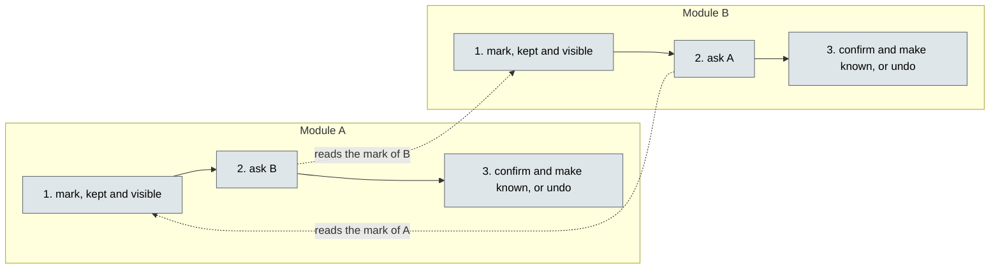

# Saga

A way to keep data right across several parts that each own their data, when one transaction cannot cover them. A saga is a **sequence of local transactions**, each in one part, coordinated reliably. When a step fails, the steps already done are undone by **compensating transactions**: new changes that cancel the effect, since a committed change cannot be rolled back.

## Two ways to coordinate

- **Choreography**: each local transaction makes an event known, and the event triggers the next local transaction in another part. Nothing coordinates, each part knows what it does when it sees an event.
- **Orchestration**: one coordinator tells each part which local transaction to run, and handles the failures.

## What it gives, and what it costs

| Gives | Costs |
| :-- | :-- |
| Consistency across parts with no transaction that spans them | **No automatic rollback**: each step needs a compensation, written and tested |
| Each part keeps its own data and its own database | **No isolation**: while a saga runs, others see the intermediate state, and two sagas can disturb each other |

The lack of isolation is the heart of the matter. A saga alone does not make a rule absolute: two sagas that run at the same moment can both pass a check. The answer is a **countermeasure**: a design choice that brings back the isolation that is missing.

## Semantic lock

One countermeasure is a **semantic lock**: the first step of a saga **marks** the record it works on, in the application's own data, to say that it is in progress, and the mark stays until the saga ends. A mark is not a database lock. It is a value that the rules of the application understand: another operation that meets the mark is refused, waits or counts it as the thing itself, as the model says.

A saga is a way to hold a rule across two modules, one among others, see [ways to hold the rule](../consistency.md#ways-to-hold-the-rule). The example below shows one form of it and what it asks of the model of a module.

## Example: mark, then ask

Take two modules with a rule across them, as in [the three cases](../consistency.md#the-three-cases): the sign-up to a meeting with a fee, refused when the owner is locked, and the deletion request of that owner, refused when a payment waits. If each asks the other first and then acts, both can find the other absent, and both succeed.

In a saga **by marks**, each module **marks** what it is doing, in its own data and in its own transaction, and **only then asks** the other. The answer is yes or no, and the module confirms or undoes its mark.

*Each side does its three steps in order. The dotted arrows are the questions: each reads data of the other that is already kept.*

**Why both cannot succeed.** Each question comes after the mark of its own side. If A's question did not see B's mark, A's question came before B's mark. Then A's mark came before B's mark, and so before B's question, which sees it. At least one of the two refuses. This holds under two conditions:

- **A question reads only what is kept**, never what is in progress.
- **A mark counts as the thing itself** for the question of the other side. A place being checked counts as a payment that waits, and an account whose lock is being checked counts as locked.

**What it asks of the model, and what it costs.**

- **An intermediate state.** The place is being checked before it is awaiting payment, and the account is locked before the open items are known. This state is part of the model of the module.
- **An undo**, which is a command like the others, with its own rules.
- **A double refusal.** When both marks are visible at the same moment, both sides can refuse. The rule stays kept and nothing wrong is done: the person tries again.
- **A mark left by a failure.** If the module fails between the mark and its verdict, the mark stays, and counts. It expires on a date and is undone, see [D4](../drivers.md#d4-things-happen-because-time-passes). The safe side is to refuse.
- **The fact is made known at the verdict**, never at the mark, see [a change and its fact](../consistency.md#a-change-and-its-fact), so that no other module acts on a mark that is then undone.

Applied to the three cases, with the question each side asks:

| Rule | Module A, its mark, its question | Module B, its mark, its question |
| :-- | :-- | :-- |
| A sign-up to a meeting with a fee, and the deletion request of the owner | **Meetings:** the place is being checked. It asks Accounts whether the owner is locked. Undone: the place is released | **Accounts:** the account is locked. It asks Meetings and Payments for the open items. Undone: the account is unlocked |
| A payout account removed, and a fee or an acceptance of a hand-over | **Payments:** the account is being removed. It asks Meetings whether a meeting with a fee is yet to start. Undone: the account stays | **Meetings:** the fee, or the acceptance, is being checked. It asks Payments whether the owner holds a validated payout account. Undone: the fee is not set, the acceptance does not count |
| The final check of a deletion, and a host who leaves | **Accounts:** the account is *being carried out*. It asks Meetings for the open items again. Undone: the account stays locked | **Meetings:** the member leaves. It asks Accounts whether a host who remains is being carried out. Undone: the member is back |

In the third case, the mark *being carried out* lives only during the final check, so it refuses a departure for a moment, never for the whole grace period. It would add a state to the account and a question to the Contract of Accounts, which is the kind of consequence an implementation choice has on the model and on [between modules](../between-modules.md#what-each-module-sends-and-receives).

## In this project

- Which way holds the rules across two modules is a choice of the technical decisions, among [the ways](../consistency.md#ways-to-hold-the-rule). The saga by marks above is an example, not the decision.
- Whichever saga is used, its steps are a local transaction, a [question](../between-modules.md#two-kinds-of-message) to the other module, then a confirmation or an undo, each a command of the module, see [use cases](../use-cases.md#commands).
- Where an outside system answers in its own time, a saga by facts is the natural form, see the [payment of a fee](../between-modules.md#a-member-signs-up-to-a-meeting-with-a-fee).

## Sources

- Hector Garcia-Molina and Kenneth Salem, [Sagas](https://www.cs.cornell.edu/andru/cs711/2002fa/reading/sagas.pdf), ACM SIGMOD, 1987.
- Chris Richardson, [Pattern: Saga](https://microservices.io/patterns/data/saga.html), and [Pattern: Database per service](https://microservices.io/patterns/data/database-per-service.html).
- Chris Richardson, *Microservices Patterns*, 2018, chapter 4: the countermeasures for the lack of isolation, the semantic lock among them.
