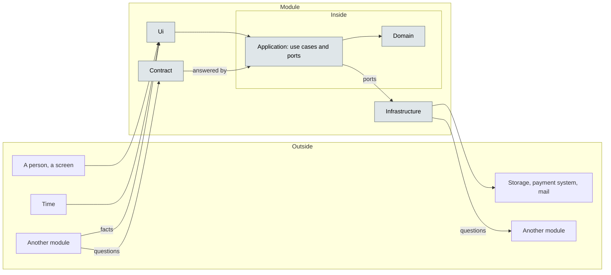

# Modules and layers

This page cuts the code in two ways: into **modules**, one for each context of the domain, and into **layers** inside each module. It answers D1 and D3 of [what the domain demands](drivers.md) in part, and gives a place to every other demand.

Concepts used: [modular monolith](concepts/modular-monolith.md), [model tension](concepts/model-tension.md) and [hexagonal architecture](concepts/hexagonal-architecture.md).

## One module for each context

The application is a single deployable whole, a **modular monolith**, cut into four modules that carry the names of the four contexts of the [domain](../domain/README.md#the-four-contexts):

| Module | Context |
| :-- | :-- |
| Accounts | [Accounts](../domain/accounts/description.md) |
| Meetings | [Meetings](../domain/meetings/description.md) |
| Payments | [Payments](../domain/payments/description.md) |
| Notifications | [Notifications](../domain/notifications/description.md) |

A module is the code of one context and of nothing else: its words are those of its glossary, its data is its own and nobody else reads it. There is no module for the administrators, since what an administrator decides belongs to the context that guards the action.

**No constraint crosses two modules.** There is no foreign key, no shared table, no join and no uniqueness constraint over the data of two modules. A reference to something that belongs to another module is its **identity**, such as a member or a payer, and nothing guarantees that it still exists: the module that holds it asks the other, or receives a fact, see [between modules](between-modules.md). A rule that would need such a constraint is held in another way, one of those listed in [consistency](consistency.md#ways-to-hold-the-rule). This is what keeps each module's data movable on its own, see [ready to be extracted](concepts/modular-monolith.md#ready-to-be-extracted).

A **shared kernel** holds the few things every module needs and that carry no rule of the domain, such as the identity of a person, a date, or the way a refusal is expressed. It stays small: it holds only what carries no language of any context, and that every module would write the same way.

## The layers of a module

Each module is made of five parts. Four of them are layers, the fifth is the face the module shows to the others.

| Part | What it holds |
| :-- | :-- |
| **Domain** | The model: aggregates, value objects, the rules and the domain events. It knows nothing else. |
| **Application** | The use cases, which orchestrate the domain, the **ports**: what the module needs from the outside, written as interfaces in the language of the domain, and the answers to the questions of its Contract. |
| **Infrastructure** | The **adapters** of the ports that go out: storage, outside systems, the clock, the sending of messages. |
| **Ui** | The **adapters** that come in: what turns a request from outside into a call of a use case. |
| **Contract** | What the module offers to the other modules, in two parts: the **facts** it makes known, as data types, and the **questions** it answers, as interfaces that the module implements. It is the only part another module may see. |

In the vocabulary of the [hexagonal architecture](concepts/hexagonal-architecture.md), Domain and Application are the inside of the hexagon. Ui holds the **driving adapters**, which start a use case. Infrastructure holds the **driven adapters**, which the use cases call through the ports.

*Whatever starts a use case comes in through Ui: a person, a date or a fact of another module. A question of another module reaches the Contract, and the Application answers it. Whatever a use case needs from the outside goes through a port, and Infrastructure plugs the outside system into it, a question to another module included.*

## Who may depend on whom

The rule is a single one: **dependencies point inwards**. The domain depends on no infrastructure, and the outside depends on the inside, never the reverse. A library of pure computation, with no input or output and no state, may enter the domain when it is listed in the module boundaries ([ADR 0002](../adr/0002-allow-pure-computation-libraries-in-the-domain.md)).

| Part | May depend on |
| :-- | :-- |
| Domain | Itself, the domain part of the shared kernel and the libraries of pure computation listed in the module boundaries |
| Application | Its own Domain, its own Contract (to make facts known and to answer questions) and the shared kernel |
| Infrastructure | Its own Application and Domain, the shared kernel and the Questions of the Contract of other modules |
| Ui | Its own Application, and the Facts of the Contract of other modules. Never its own Domain or its Infrastructure |
| Contract | The shared kernel only |
| Another module | The Contract of a module, nothing else of it |

A rule that a tool can check is checked by a tool, so that the architecture does not slowly drift from its description. The rules above are the ones the module boundaries are checked against.

Two consequences follow:

- The domain can be tested alone, with no database, no network and no screen, and it reads like the glossary.
- Another outside system, or another way to start a use case, replaces an adapter and changes nothing in the inside.

## The contract of a module

A module reaches another only through its **Contract**. The Contract holds what a module makes available, in two separate parts: the **facts** it lets others know, and the **questions** it lets others ask of it. It carries no rule: the facts are data types, and the questions are interfaces that the owner of the Contract implements in its Application, from its own model. The module that asks reaches them through a port of its own, written in its own words, and an adapter of its Infrastructure, see [between modules](between-modules.md#the-contract-has-two-parts).

What goes through the Contract is what the tables "What X needs from other contexts" of the [domain](drivers.md#d1-each-context-has-its-own-data-and-needs-information-from-the-others) list. Which of the two parts each item belongs to is settled in [between modules](between-modules.md#what-each-module-sends-and-receives).

## What lives in each part, by demand

| Demand | Where its answer lives |
| :-- | :-- |
| D1 information from other contexts | The Contract of the context that owns it, and a port of the one that needs it |
| D2 absolute rules | The Domain, for a rule inside an aggregate; a domain service for a rule across aggregates. See [consistency](consistency.md#rules-that-hold-at-the-same-moment) |
| D3 access | The Application, before a use case: the module reads the access from Accounts, then decides |
| D4 time | A driving adapter in Ui that starts a use case on a date |
| D5 outside systems | A port in the Application, an adapter in Infrastructure |
| D6 notifications | A port in the Application of the context that has a fact to report |
| D7 reading | The read side of the Application, see [use cases](use-cases.md#queries) |
| D8 erasure and export | A use case in each module, started by the deletion |

Sources of the concepts are in the [concepts](concepts) pages.
