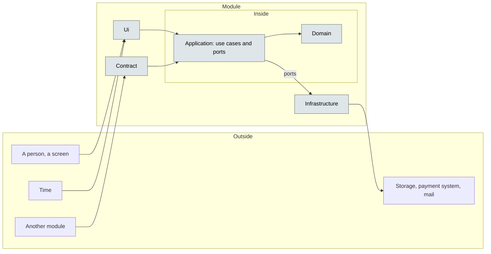

# Modules and layers

This page cuts the code in two ways: into **modules**, one for each context of the domain, and into **layers** inside each module. It answers D1 and D3 of [what the domain demands](drivers.md) in part, and gives a place to every other demand.

Concepts used: [modular monolith](concepts/modular-monolith.md) and [hexagonal architecture](concepts/hexagonal-architecture.md).

## One module for each context

The application is a single deployable whole, a **modular monolith**, cut into five modules that carry the names of the five contexts of the [domain](../domain/README.md#the-five-contexts):

| Module | Context |
| :-- | :-- |
| Registrations | [Registrations](../domain/registrations/description.md) |
| UserAccess | [UserAccess](../domain/useraccess/description.md) |
| Meetings | [Meetings](../domain/meetings/description.md) |
| Payments | [Payments](../domain/payments/description.md) |
| Notifications | [Notifications](../domain/notifications/description.md) |

A module is the code of one context and of nothing else: its words are those of its glossary, its data is its own and nobody else reads it. There is no module for the administrators, since what an administrator decides belongs to the context that guards the action.

A **shared kernel** holds the few things every module needs and that carry no rule of the domain, such as the identity of a person, a date, or the way a refusal is expressed. It stays small: each addition must be wanted by at least two modules.

## The layers of a module

Each module is made of five parts. Four of them are layers, the fifth is the face the module shows to the others.

| Part | What it holds |
| :-- | :-- |
| **Domain** | The model: aggregates, value objects, the rules and the facts that happen in the domain. It knows nothing else. |
| **Application** | The use cases, which orchestrate the domain, and the **ports**: what the module needs from the outside, written as interfaces in the language of the domain. |
| **Infrastructure** | The **adapters** of the ports that go out: storage, outside systems, the clock, the sending of messages. |
| **Ui** | The **adapters** that come in: what turns a request from outside into a call of a use case. |
| **Contract** | What the module offers to the other modules, and what it makes known to them. It is the only part another module may see. |

In the vocabulary of the [hexagonal architecture](concepts/hexagonal-architecture.md), Domain and Application are the inside of the hexagon. Ui holds the **driving adapters**, which start a use case. Infrastructure holds the **driven adapters**, which the use cases call through the ports.

*Whatever starts a use case comes in through Ui or through Contract. Whatever a use case needs from the outside goes through a port, and Infrastructure plugs the outside system into it.*

## Who may depend on whom

The rule is a single one: **dependencies point inwards**. The domain depends on nothing outside itself, and the outside depends on the inside, never the reverse.

| Part | May depend on |
| :-- | :-- |
| Domain | Itself and the domain part of the shared kernel |
| Application | Its own Domain, the shared kernel and the Contract of other modules |
| Infrastructure | Its own Application and Domain, and the shared kernel |
| Ui | Its own Application only, never its Domain or its Infrastructure |
| Contract | The shared kernel only |
| Another module | The Contract of a module, nothing else of it |

A rule that a tool can check is checked by a tool, so that the architecture does not slowly drift from its description. The rules above are the ones the module boundaries are checked against.

Two consequences follow:

- The domain can be tested alone, with no database, no network and no screen, and it reads like the glossary.
- Another outside system, or another way to start a use case, replaces an adapter and changes nothing in the inside.

## The contract of a module

A module reaches another only through its **Contract**. The Contract holds what a module makes available: what it lets others know, and what it lets others ask of it. It carries no rule, only data.

What goes through the Contract is what the tables "What X needs from other contexts" of the [domain](drivers.md#d1-each-context-has-its-own-data-and-needs-information-from-the-others) list. How each item goes through, requested at the moment it is needed or kept up to date beforehand, is the subject of the page on how the modules work together.

## What lives in each part, by demand

| Demand | Where its answer lives |
| :-- | :-- |
| D1 information from other contexts | The Contract of the context that owns it, and a port of the one that needs it |
| D2 absolute rules | The Domain, for a rule inside an aggregate; a domain service for a rule across aggregates. See the page on consistency |
| D3 permissions | The Application, before a use case: the module declares its permissions and UserAccess answers |
| D4 time | A driving adapter in Ui that starts a use case on a date |
| D5 outside systems | A port in the Application, an adapter in Infrastructure |
| D6 notifications | A port in the Application of the context that has a fact to report |
| D7 reading | The read side of the Application, see [use cases](use-cases.md#queries) |
| D8 erasure and export | A use case in each module, started by the deletion |

Sources of the concepts are in the [concepts](concepts/) pages.
