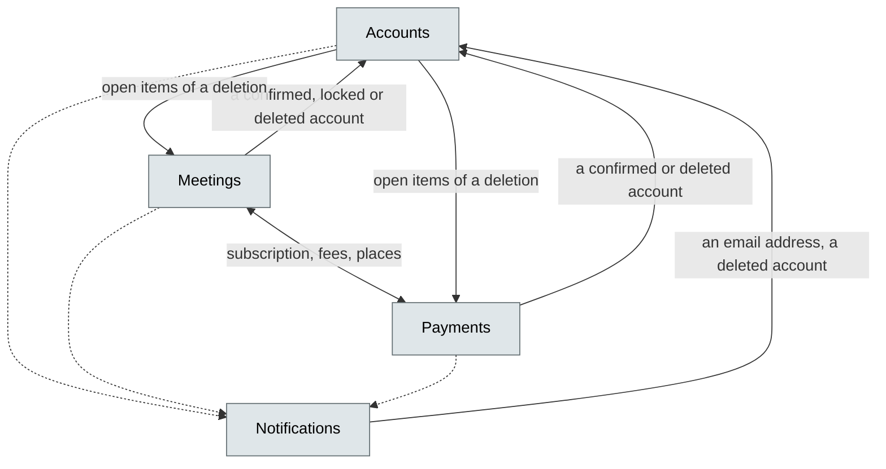

# The domain

The application lets people form communities around a place and meet. Members propose **meeting groups**, groups organize **meetings**, members sign up, wait for a place, comment and pay the fee of a meeting, and the owners of the groups pay a subscription that keeps their groups able to organize.

This page is the way in. It says what the contexts are, how they depend on one another, how a person goes through them, and which rules cross their borders. The details are in the pages of each context.

## How the documentation is organized

Every context has a **description**, which says what the context does and what it needs from the others. Each topic of a context then has three pages: the topic itself, its **conceptual model** and its **event storming**. The terms are defined once, in the **glossary** of the context, and the pages link to them.

A reader who wants the whole picture reads this page, then the description of each context in the order of the table below, then the topics that interest them.

## The four contexts

| Context | What it is for | Main notions | Start here | Glossary |
| :-- | :-- | :-- | :-- | :-- |
| **Accounts** | Know who the people are and what each may do, from the registration to the deletion of the account | Account, registration, invitation, confirmation link, role, permission, locked account, deletion of an account, profile | [Description](accounts/description.md) | [Glossary](../../src/Accounts/GLOSSARY.md) |
| **Meetings** | Form communities and meet | Meeting group, proposal, meeting, attendee, waitlist, host, comment, hand-over | [Description](meetings/description.md) | [Glossary](../../src/Meetings/GLOSSARY.md) |
| **Payments** | Handle the money | Subscription, free trial, free plan, meeting fee, payout account, price list | [Description](payments/description.md) | [Glossary](../../src/Payments/GLOSSARY.md) |
| **Notifications** | Reach a person about something that happened | Notification, inbox, delivery, catalogue, required message | [Description](notifications/description.md) | [Glossary](../../src/Notifications/GLOSSARY.md) |

There is no context for administration: what an administrator decides belongs to the context that guards the action, such as the proposals of meeting groups in Meetings or the price list in Payments. See [roles and permissions](accounts/description.md#permissions).

## How the contexts depend on one another

Each context owns its data and never reads another context's data directly. What a context needs from another is written in the table "What X needs from other contexts" of its description, with how exact and how fresh it must be. The domain never says how the information is obtained.

*A solid arrow reads "needs to know from". A dotted arrow reads "hands a fact to": the context decides that someone must be notified and gives Notifications the kind, the member and the data. The double arrow between Meetings and Payments stands for what each needs from the other: Meetings needs the validity of a subscription, a fee paid and a payout account; Payments needs a place awaiting payment, a lost place and whether a meeting with a fee has yet to start.*

Two dependencies are not drawn, because they concern every context: each one needs Accounts to know whether the role of an account grants a permission, and every action is checked this way.

## One person, several names

A person is a single **user**, who holds one account, and each context sees them with the name that suits what it does with them.

| Person | Accounts | Meetings | Payments |
| :-- | :-- | :-- | :-- |
| Someone who registered | Account with the Member role | Member | Payer |
| Someone who was invited | Account with the Administrator role | Nothing: an administrator is not a member, and reads everything in Meetings | Nothing: an administrator is not a payer, and manages the price list |

An account has **exactly one role**, Member or Administrator, and there is no way to turn a member into an administrator. See [roles](accounts/description.md#roles).

Inside a meeting group, a member has one of these places, seen from Meetings, see [roles in a group](meetings/group-life.md#roles-in-a-group):

- the **owner**, answerable for the group and its subscription,
- an **organizer**, who looks after the group below the owner,
- an ordinary **member**.

On one meeting, a member may be an **attendee**, or a **host**. A host holds the meeting and takes no place in it, see [hosts](meetings/organization.md#hosts).

## A journey through the contexts

The pages below follow a member from the first registration to the deletion of their account.

1. **Registering.** A person gives an email address and follows the link sent to it, then chooses a login, names and a password. The confirmation makes the account confirmed and creates the member and the payer, each in its own context. See [registering](accounts/registration.md#registering) and [confirming](accounts/registration.md#confirming).
2. **Proposing a group.** The member proposes a meeting group. An administrator accepts or rejects the proposal, and an accepted proposal becomes a group whose first owner is the proposer. A member who never held a subscription may own one group on the free plan. See [creating a meeting group](meetings/group-creation.md).
3. **Subscribing.** The owner starts a free trial or buys a subscription, for a month or a year, and renews it. While it is valid, the group can organize meetings. See [subscriptions](payments/subscriptions.md) and [covering the group](meetings/group-life.md#covering-the-group).
4. **Organizing meetings.** The owner and the organizers create meetings, with an optional fee, and designate hosts. For a meeting with a fee, the owner first sets up a payout account. See [organizing meetings](meetings/organization.md) and [the payout account](payments/meeting-fees.md#the-payout-account).
5. **Signing up and paying.** Other members join the group and sign up to a meeting. For a meeting with a fee, the place is guaranteed once the fee is paid. For a meeting without a fee, a waitlist takes the places that become free. See [signing up](meetings/organization.md#signing-up), [the waitlist](meetings/organization.md#the-waitlist) and [meeting fees](payments/meeting-fees.md).
6. **Commenting.** Members of the group comment on a meeting, reply and like, and the owner and the organizers moderate. See [commenting](meetings/commenting.md).
7. **Being notified.** All along, the member reads their inbox and receives emails. See [Notifications](notifications/description.md) and [the catalogue](notifications/catalogue.md).
8. **Handing a group over.** The owner may hand a group over to another member, who must hold a valid subscription for it to complete. See [handing the group over](meetings/group-life.md#handing-the-group-over).
9. **Looking after one's profile.** The user changes their email address or their password, or gets back in after forgetting the password. See [profile management](accounts/profile-management.md).
10. **Leaving.** The member requests the deletion of their account, settles what stands in the way, and after a grace period the account is deleted, and what it held is erased or made anonymous in every context. See [deleting an account](accounts/account-deletion.md).

## Rules that cross the contexts

- **Every rule is absolute.** A rule that spans several aggregates or contexts holds even when two operations happen at the same moment: one succeeds and the other is refused. No rule is left to chance, such as the last host of a meeting, the free plan, or the hand-over of a group.
- **Permissions are declared where the action is guarded.** Each context defines the permissions of its own actions and says whether each one reads or changes something. Accounts holds the roles and the link between roles and permissions, and no other context names a role. See [permissions](accounts/description.md#permissions).
- **A locked account reads and changes nothing, with four exceptions.** While the deletion of an account is pending, Accounts refuses the account every permission that changes something, except cancelling the request, exporting their data, marking their notifications as read and changing their password. See [locked account](accounts/account-deletion.md#locked-account).
- **One fact, one notification.** A fact that must be notified gives each member concerned one notification, never lost and never twice. See [one fact, one notification](notifications/description.md#one-fact-one-notification).
- **Money is never refunded by the application.** A refund is the owner's decision, in their own payment system. See [refunds](payments/meeting-fees.md#refunds).
- **What a context needs from another is stated, not how it is obtained.** Whether information is requested when needed or kept up to date beforehand is an implementation choice.
- **Delays and limits are configurable.** The time a payment waits, the delay of a reminder, the length of a free trial, the limits of the free plan, the grace period of a deletion and the keeping of anonymised payments each have a default, stated where the rule lives.

## What is out of scope for now

- **Notifications**: preferences, digests, push, a template editor, several languages, deleting notifications and how long they are kept. See [Notifications](notifications/description.md#what-is-out-of-scope-for-now).
- **Profile**: changing the login and the names, a second factor, cancelling an email address change from the old email address, registering with an external identity. See [profile management](accounts/profile-management.md#what-is-out-of-scope-for-now).
- **Account deletion**: deleting an account on someone else's behalf, and reversing a deletion once carried out. See [what stands outside](accounts/account-deletion.md#what-stands-outside-this-page).
