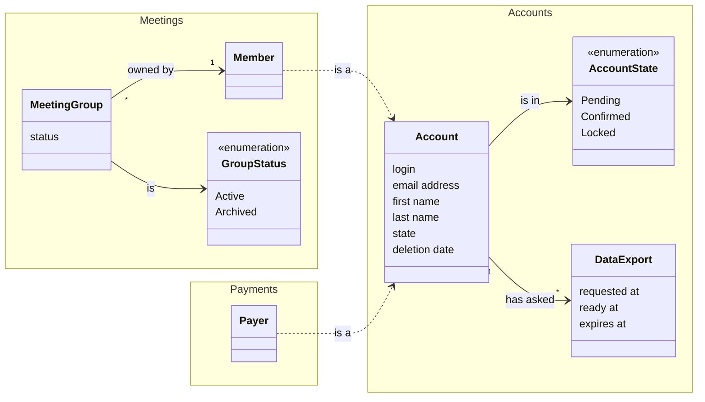

# Deleting an account: conceptual model

The things of the domain and how they relate, before any technical choice. The rules are described in [deleting an account](account-deletion.md); the behaviour is in the [event storming](account-deletion-event-storming.md). The whole life of an account is in the [conceptual model of Accounts](conceptual-model.md).

## Reading it

- **Account** is the only thing that decides the deletion. Its **state** says what it can do. **Confirmed** is the ordinary case. **Locked** is the state from the request until it ends: the account reads what it read before and changes nothing, except cancelling the request, exporting its data, marking the notifications as read and changing the password. While it is locked, the account keeps the **deletion date**, which is the end of the grace period. The account ends in one of two ways: **cancelled**, by the member or by the application when something stands in the way at the end, and it goes back to confirmed, or **deleted for good**: the login, the email address, the names and the password are erased, and nothing of the account remains.
- **Data Export** is what a member asks to receive. It is ready after a while, and expires after another. Its content is not part of the model: it is what each context holds about the person on the day.
- **Member** and **Payer** are the same person seen from Meetings and Payments. When the account is deleted, both become anonymous: the others know them as a **deleted member**, and what they hold keeps the identifier alone.
- **Meeting Group** has a status. **Archived** is final: the group is frozen, with its past, its comments and its anonymous owner. A group is archived only when its owner's account is deleted and the group was not handed over. Its owner stays its owner, shown as a deleted member.

## What is not in the model

- No list of the open items: they are read from Meetings and Payments at the request and again at its end, they are not kept.
- No choice kept for a group: an owner cannot leave, so a group owned at the end is archived, not left.
- No state between locked and deleted: the final check of the open items and the carrying out form **one decision**, with nothing able to stand in the way between them. When something stands in the way at that moment, the deletion is cancelled and the account goes back to confirmed. The parts of the carrying out are then done by each context on its own.
- No undo: the deletion is final. There is no deleted state either, since nothing of the account remains to be in one.
- No request for an administrator: an administrator is deleted by another, at once, without a request.
- No copy of the data to erase: the export is a snapshot that expires, and is the only copy the application keeps.
