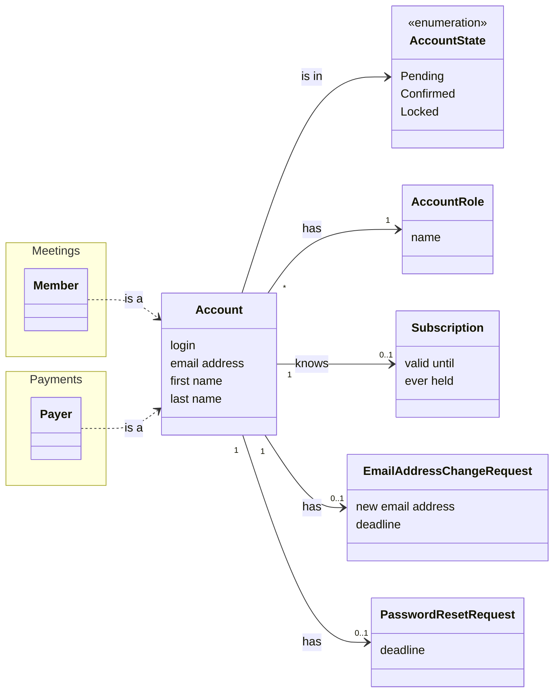
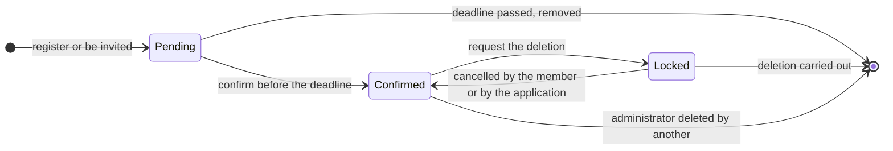

# Accounts: conceptual model

The things of the domain and how they relate, and the states an account goes through. The behaviour of each topic is in its own [event storming](registration/event-storming.md).

## The life of an account

An account is always in **one state**, and the state says what can be done with it: a pending account can do nothing, a confirmed account does what its role allows, a locked account reads and changes almost nothing, and a deleted account no longer exists: the deletion is final, and nothing of the account remains. See [the states](description.md#accounts).

## Reading it

- **Account** carries what the person gave when registering. Its identity never changes, and no two accounts share a login or an email address, whatever their state.
- **Account Role** tells what kind of account it is. There are two, Member and Administrator, and an account has exactly one, fixed when the account is created. Each context decides what a role may do in its own actions.
- **Subscription** is a value: until when the subscription of the account is valid, and whether it ever held one. Payments owns the subscription and gives a new value each time it is started, bought or renewed. It is part of the [access](description.md#access) that the other contexts read.
- **Email Address Change Request** and **Password Reset Request** are requests in progress. An account has at most one of each. They have a deadline and no status: once done, or after the deadline, they are gone.
- A **deletion request** is not a thing of its own: it is the account going from confirmed to locked, for the grace period.
- The dotted arrows are the same person seen from other contexts. Accounts does not know them: they know the account.
