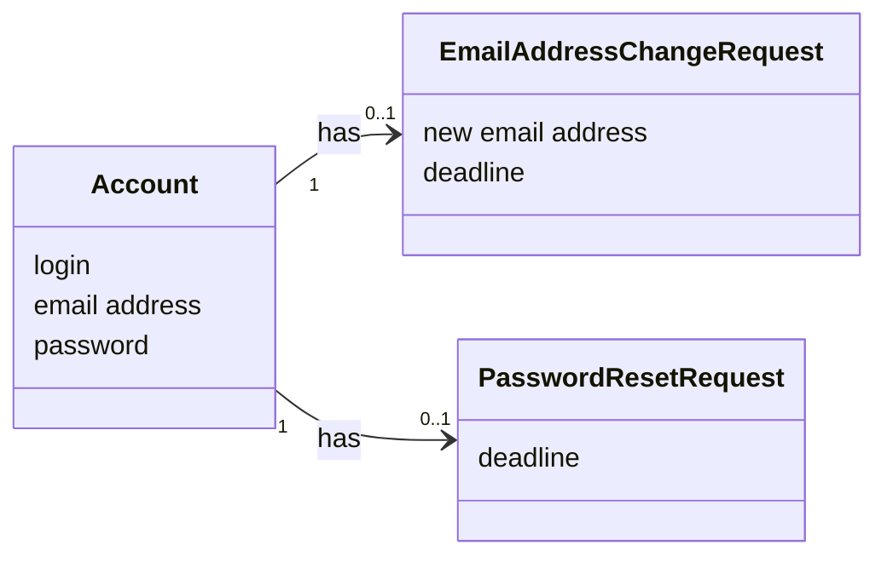

# Profile management: conceptual model

The things of the domain and how they relate, before any technical choice. The rules are described in [profile management](profile-management.md); the behaviour is in the [event storming](profile-management-event-storming.md). The whole life of an account is in the [conceptual model of Accounts](conceptual-model.md).

## Reading it

- **Account** holds the current email address and the password. Confirming an email address change or resetting a password changes the account. [Notifications](../notifications/description.md) uses the current email address, which is the old one until a change is confirmed.
- **Email Address Change Request** is a request in progress. It is created with the new email address and its deadline, 48 hours later, and only when the new email address is free; otherwise the answer is the same but nothing is created. It has **no status**: it is gone once confirmed, replaced by a newer request, dropped when the user requests the deletion of their account, or removed after its deadline.
- **Password Reset Request** is a request in progress. It is created with its deadline, 1 hour later. It has **no status**: it is gone once used, replaced by a newer request, or removed after its deadline.
- The password itself is never kept in a request: the person chooses it when following a reset link.

## Rules

- **One holder for an email address.** The email address of a request must belong to no account, pending or confirmed, when the request is made and again when it is confirmed. The rule involves every account, and holds inside Accounts. It is absolute: when two requests for the same email address are confirmed at the same moment, or one of them and a registration with that email address, only one succeeds.
- **One request of each kind for an account.** A new email address change request or password reset request replaces the previous one of its kind. The rule is absolute: when two requests of an account arrive at the same moment, only one stays.
- **A link works once.** A confirmation link or a reset link followed twice at the same moment gives only one success.

## What is not in the model

- No login and no names to change.
- No history of the email addresses an account had.
- No second factor and no choice of sessions to end.
- No cancel link in the message to the old email address.
