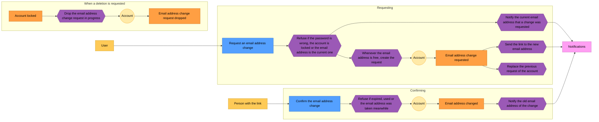
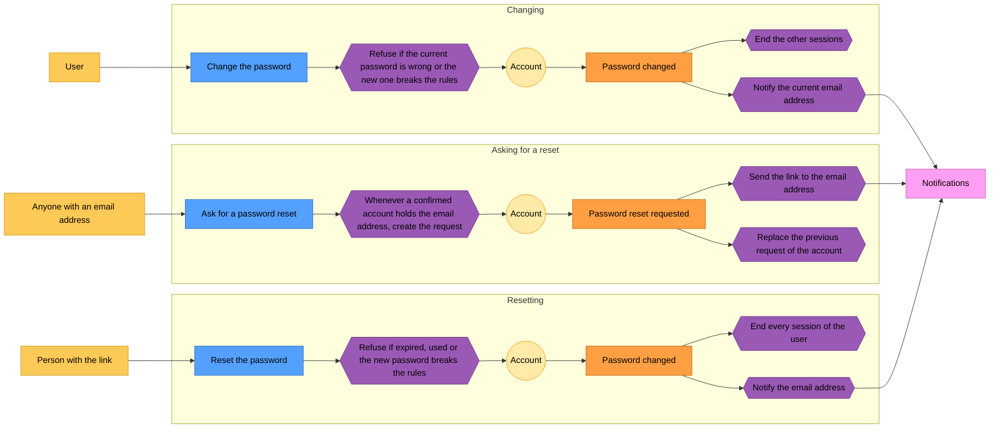

# Profile management: event storming

Event storming lays out a process as a sequence of **commands** (what someone asks), **aggregates** (what decides), **events** (what happened) and **policies** (what the system does in reaction). The [conceptual model](conceptual-model.md) shows the structure; this page shows the behaviour. The rules are in [profile management](description.md).

## Changing the email address

Blue is a command, pale yellow an aggregate, orange an event, purple a policy, darker yellow someone who asks for a command, pink another context.

1. **Requesting.** The refusals come first. Then the same answer goes back whatever the email address. When it is free, the request is created and the link goes to the new email address; when it is held by an account, confirmed or pending, nothing is created and nothing is sent to the holder. In every case the current email address is told that a change was requested.
2. **One at a time.** A new request replaces the previous one, whose link stops working.
3. **Confirming.** The link works once and before its deadline. The email address is checked again: if another account took it meanwhile, the link is refused as expired or invalid. Then the account takes the new email address, the old one is free, and the old one is told. Sessions go on.
4. **Deleting.** When the user requests the deletion of their account, the account is locked and the request in progress, if any, is dropped.

## Changing and resetting the password

Blue is a command, pale yellow an aggregate, orange an event, purple a policy, darker yellow someone who asks for a command, pink another context.

1. **Changing.** The current password is checked, and the new one must follow the rules. The other sessions end, the current one goes on, and the current email address is told. A locked account may do it.
2. **Asking.** The answer is the same sentence and takes the same time whatever the email address. For a confirmed account, a request is created, replacing the previous one, and the link goes to the email address; when no account holds it, or only a pending one, nothing happens and nothing is sent.
3. **Resetting.** The link works once and for 1 hour. Following it, the person chooses a password that follows the rules. Every session of the user ends, and the email address is told that the password changed. A locked account and an administrator can reset.
