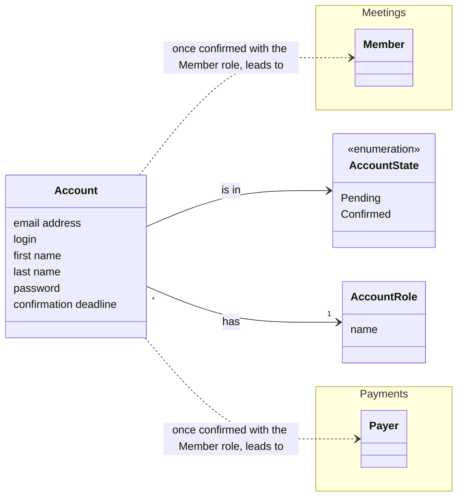

# Registration: conceptual model

A conceptual model shows the things of the domain and how they relate, before any technical choice. Behaviour is in the [event storming](event-storming.md). The whole life of an account is in the [conceptual model of Accounts](../conceptual-model.md).

## Reading it

- **Account** is the only thing of the registration. It has an identity of its own, which no other attribute replaces: the email address can change. It is created pending with only the **email address** and the moment it stops being confirmable (48 hours after the latest link was sent). The login, the names and the password are given when the account is confirmed, for a registration as for an invitation.
- **The role** is fixed when the account is created: Member for someone who registers, Administrator for someone who is invited. It lives in the [conceptual model of Accounts](../conceptual-model.md), and stays for the life of the account.
- **State** has two values here, Pending and Confirmed. An account that is not confirmed in time is not given a third state: it is removed, and "expired" is simply a deadline in the past. The other state, locked, belongs to [deleting an account](../account-deletion/description.md), which ends with the account deleted for good.
- **Member** and **Payer** are created by Meetings and Payments once the account is confirmed with the Member role. They keep no other tie with the registration.

## Rules

- **One holder for an email address**, pending or confirmed account alike, absolute.
- **One holder for a login**, checked when the account is confirmed, absolute.
- **A link works until the deadline, the confirmation or the next link sent.** Validating the form twice at the same moment gives only one confirmation. How the link is made is in [ADR 0001](../../../adr/0001-confirmation-link-as-a-signed-uri.md).

## The same person, seen from several contexts

Someone who registers as a member is a different thing in each context:

- in Accounts, an **Account**,
- in Meetings, a **Member**,
- in Payments, a **Payer**.

They share the identity of the account, and nothing else. An invited administrator is an **Account** only.
