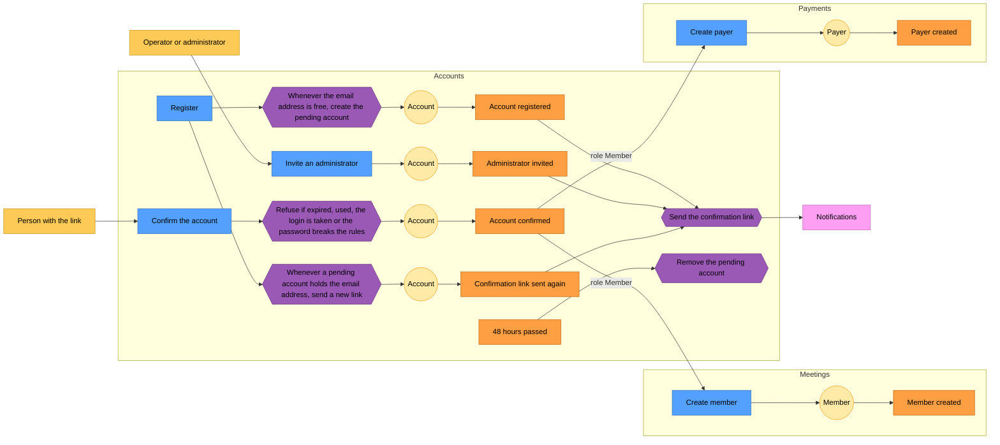

# Registration: event storming

Event storming lays out a process as a sequence of **commands** (what someone asks), **aggregates** (what decides), **events** (what happened) and **policies** (what the system does in reaction). The [conceptual model](conceptual-model.md) shows the structure; this page shows the behaviour.

Blue is a command, pale yellow an aggregate, orange an event, purple a policy, darker yellow someone who asks for a command, pink an external system.

## Reading it

1. **Registering.** The person gives an email address. When it is free, a pending account is created for the Member role, and the confirmation link goes out as a reaction to the event, not as part of the command. When a confirmed account holds it, nothing happens. The answer is the same in every case.
2. **Inviting.** The operator or an administrator invites someone. A pending account is created for the Administrator role, with only the email address, and the same policy sends the link.
3. **Registering again.** When a pending account holds the email address, no account is created: a new link is sent and the deadline starts again, even past the previous deadline, as long as the account was not removed.
4. **Confirming.** The person follows the link, fills in the form and validates it. The account goes from pending to confirmed, if it is still pending and before its deadline, and if the login is free. This is the only fact of the registration that other contexts need.
5. **After the confirmation.** Meetings and Payments create a member and a payer, only for the Member role, in reaction to the same event, and they do not wait for each other. Accounts creates nothing: the account is the same one, now confirmed.
6. **Expiring.** When 48 hours pass without confirmation, the pending account is removed. Nobody asked for it: it is time that triggers it.
