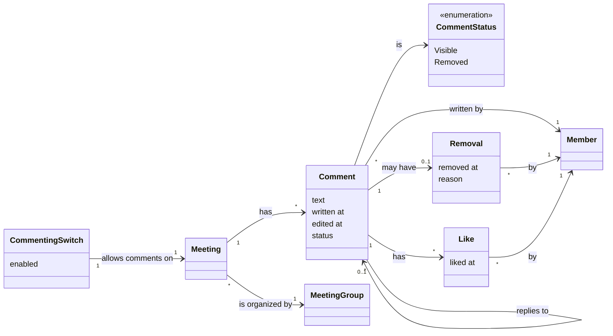

# Meetings: conceptual model of commenting

The things of the domain and how they relate, before any technical choice. The rules are described in [commenting](commenting.md); the behaviour is in the [event storming](commenting-event-storming.md). The meeting being commented is in the [conceptual model of organizing meetings](organization-conceptual-model.md).

## Reading it

- **Commenting Switch** belongs to one meeting and is created enabled with it. Besides the archiving of the group, it is the only thing that allows or forbids comments, and only the owner and the organizers of the meeting's group change it.
- **Comment** is written by a member of the group on a meeting, and remembers its text, when it was written and when it was edited. A **reply** is a comment that replies to another, and the model keeps one level: a reply never has a reply of its own.
- **Comment Status** says whether the comment is still shown or was removed. A removed comment keeps its place in the conversation, so that its replies stay readable, and is final.
- **Removal** records who removed a comment and when, and the reason when it was removed by somebody other than its author.
- **Like** links a member to a comment, once. It is taken back by removing it, and a member's likes are counted by the comment: its number of likes is what readers see.
- **Archived group.** When the meeting's group is archived, the switch acts as if it were off and moderation stops too: no comment is written, edited, liked or removed, and the switch does not change.
- **Meeting Group** is where the roles come from: the writer must be a member of the group, and the owner and the organizers are the ones who moderate. A meeting cannot change group, so a comment always belongs to the same one.

## What is not in the model

- No limit on the number of comments or replies. The text of each has at most 2000 characters.
- No history of the edits of a comment, only the date of the last one.
- No history of likes taken back.
- No attachment, mention or reaction other than the like.
- No link between a comment and the attendance of its author: a member does not need to attend to comment.
