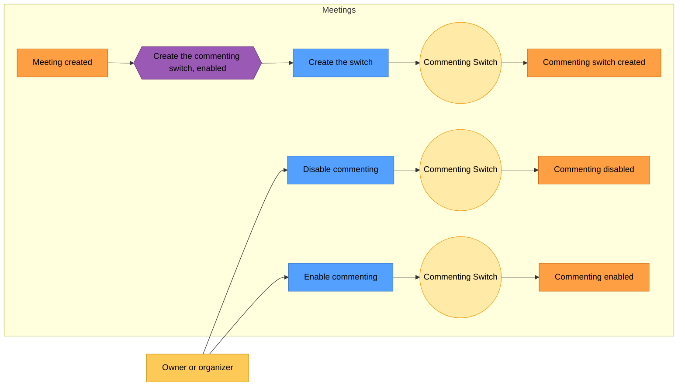
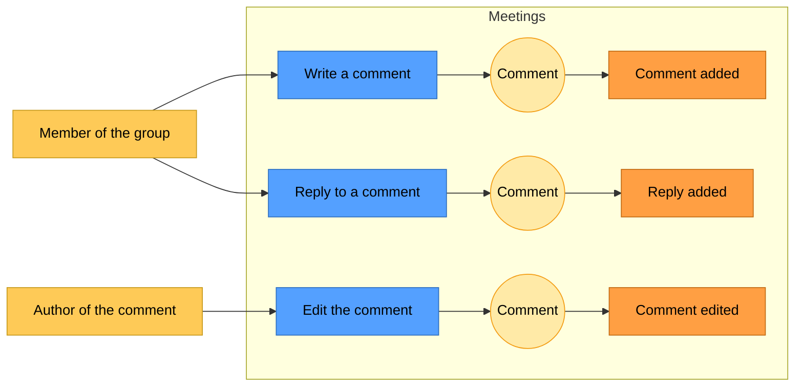
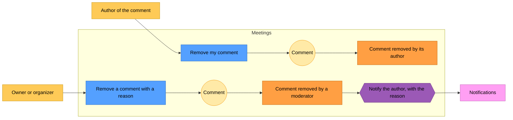
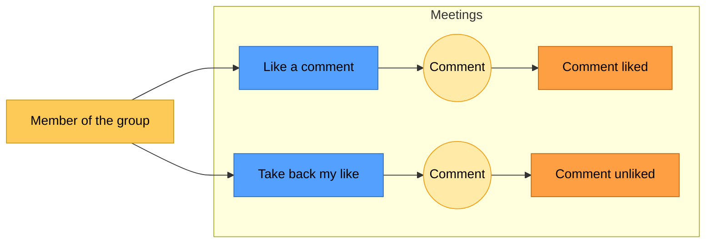
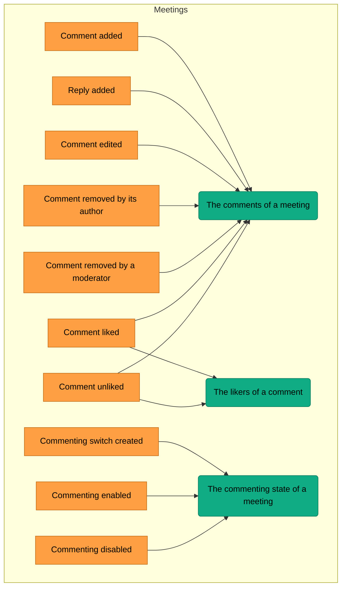

# Meetings: event storming of commenting

Event storming lays out a process as a sequence of **commands** (what someone asks), **aggregates** (what decides), **events** (what happened) and **policies** (what the system does in reaction). The [conceptual model](commenting-conceptual-model.md) shows the structure; this page shows the behaviour described in [commenting](commenting.md). It has four parts: the switch, writing and editing, removing, and likes, then the reading.

## The switch

Blue is a command, pale yellow an aggregate, orange an event, purple a policy, darker yellow someone who asks for a command.

1. **Creating.** Every meeting gets its switch when it is created, enabled.
2. **Turning it off or on.** Only the owner and the organizers of the group can. Asking for the state the switch is already in is accepted and raises no event.
3. **What it blocks.** The writing, the replying, the editing and the likes in the next parts check the switch. Removing does not.

## Writing, replying and editing

Blue is a command, pale yellow an aggregate, orange an event, darker yellow someone who asks for a command.

1. **Writing.** The comment is refused unless the author is a member of the group, commenting is enabled and the text is not empty and has at most 2000 characters. The meeting's cancellation or end does not matter.
2. **Replying.** The same checks apply, and the comment answered must not be removed. A reply to a reply attaches to the comment it answers, so a reply never has replies of its own.
3. **Editing.** Only the author, with a text that is not empty and has at most 2000 characters, while commenting is enabled and the comment is not removed. The comment remembers when it was edited.
4. **Membership.** The writer is checked against the members of the group at that moment. A member who left cannot write, but what they wrote stays.

## Removing

Blue is a command, pale yellow an aggregate, orange an event, purple a policy, darker yellow someone who asks for a command, pink an external system.

1. **By the author.** No reason is asked. The author may be a former member of the group, who then cannot: only the owner and the organizers remove their comment.
2. **By the owner or an organizer.** The reason is mandatory. The comment stays in the conversation as removed, with the person who removed it and the reason.
3. **After the removal.** The comment can no longer be edited, replied to or liked, and its likes are no longer shown. Removal is final, and works whether commenting is enabled or not.
4. **Notification.** Only a removal by somebody else tells the author, with the reason. Nothing is sent when somebody replies or likes.

## Likes

Blue is a command, pale yellow an aggregate, orange an event, darker yellow someone who asks for a command.

1. **Liking.** The member must belong to the group, commenting must be enabled and the comment must not be removed. A member likes a comment once, their own included.
2. **Taking back.** The same conditions apply, and the member must have liked the comment.

## Reading

Orange is an event, green a read model.

1. **The comments of a meeting.** It follows every event of the comments: their writing, their edits, their removal, and the likes that give each comment its count.
2. **The likers of a comment.** It follows the likes and the likes taken back.
3. **The commenting state.** It follows the switch.
4. **Who sees what.** The views do not change anything, so they raise no event of their own. Who is allowed to see each one is in [commenting](commenting.md#reading).
