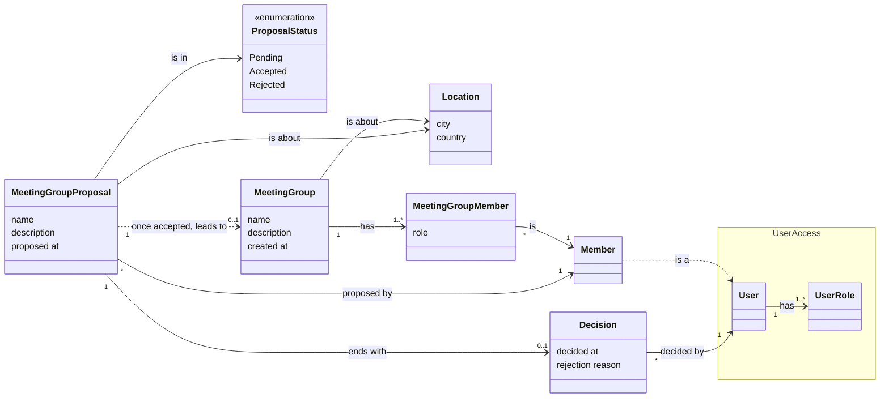

# Meetings: conceptual model of the group creation

The things of the domain and how they relate, before any technical choice. The path from a proposal to a group is described in [creating a meeting group](group-creation.md); the behaviour is in the [event storming](group-creation-event-storming.md).

## Reading it

- **Meeting Group Proposal** is the aggregate at the centre. It carries what the member asked for: a name, an optional description and a place. It is made by one member, and a member can make many.
- **Status** has three values. A proposal starts pending and ends accepted or rejected, never back.
- **Decision** exists only once the proposal is decided, which is why it is optional. It keeps the moment of the decision and, for a rejection, the reason. An acceptance has no reason.
- **Decided by** points at a **User** of [UserAccess](../useraccess/conceptual-model.md), not at a member: an administrator is a user who holds the Administrator role, and Meetings keeps nothing more about them than that identity. The proposal holds the same kind of pointer at its proposer, but a **Member**, which is Meetings' own view of that person.
- **Meeting Group** exists only from an accepted proposal, and a proposal leads to one group at most. It takes the name, the description and the place of the proposal, and from then on lives on its own: a later change to one does not touch the other.
- **Meeting Group Member** links a group to a member and gives the member a role. At creation there is exactly one: the proposer, as the first **Organizer**. The rest of the membership is described with the [meeting groups](description.md), not here.

## What is not in the model

- The proposal does not hold a name for its proposer or for the administrator who decided: only their identity. A screen that shows names asks for them elsewhere.
- No link joins a rejected proposal to a later one by the same member.
