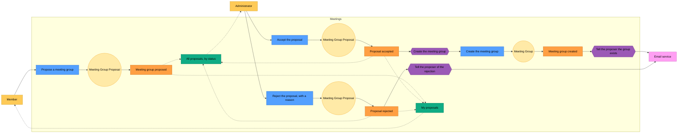

# Meetings: event storming of the group creation

Event storming lays out a process as a sequence of **commands** (what someone asks), **aggregates** (what decides), **events** (what happened) and **policies** (what the system does in reaction). The [conceptual model](group-creation-conceptual-model.md) shows the structure; this page shows the behaviour of [creating a meeting group](group-creation.md).

Blue is a command, pale yellow an aggregate, orange an event, purple a policy, darker yellow someone who asks for a command or reads, green a read model, pink an external system. Dotted arrows feed a read model.

## Reading it

1. **Proposing.** A member proposes a group. The proposal is created pending, and nothing else happens on its own: it waits for an administrator.
2. **Accepting.** An administrator accepts a proposal that is still pending. A proposal is decided once: an already decided proposal refuses a second decision, accepted or rejected.
3. **Creating the group.** The acceptance is the only thing that creates a group, and it does so as a reaction, not as part of the command. The group is created with the proposer as its first organizer, which makes the proposer a member of the group at the same moment.
4. **Telling the proposer of the creation.** In reaction to the creation of the group, an email tells the proposer that it exists.
5. **Rejecting.** An administrator rejects a proposal that is still pending, and must give a reason: a rejection without a reason is refused. No group is created.
6. **Telling the proposer of the rejection.** In reaction to the rejection, an email gives the proposer the reason. The proposal stays visible to them, with that reason.
7. **Reading.** Two read models are kept up to date by the three events of the proposal: the member's own proposals, with their status and the reason of a rejection, and the list of all the proposals, which the administrator filters by status.

Everything here belongs to Meetings. The administrator and the member come from [UserAccess](../useraccess/description.md): they are known by their identity, and the permissions that allow each command are those of the table in [creating a meeting group](group-creation.md#what-each-role-sees).
