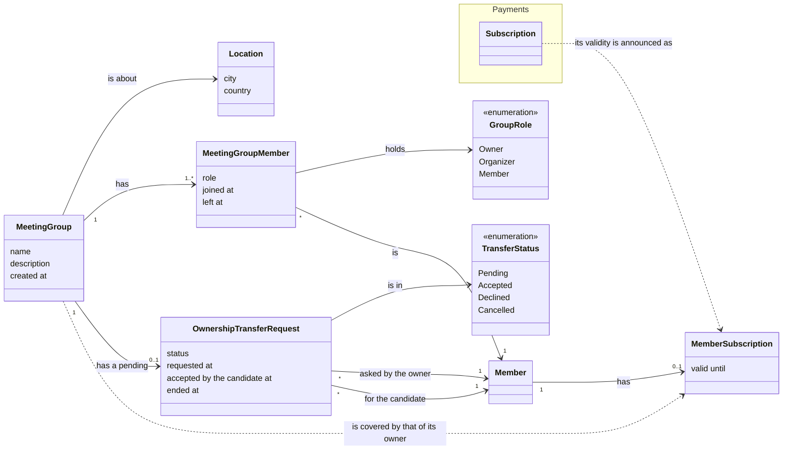

# Meetings: conceptual model of the life of a group

The things of the domain and how they relate, before any technical choice. The rules are described in [the life of a meeting group](group-life.md); the behaviour is in the [event storming](group-life-event-storming.md). The group's birth is in the [conceptual model of its creation](group-creation-conceptual-model.md).

## Reading it

- **Meeting Group** is the aggregate at the centre. It holds its members and the rules on their roles: joining, leaving, appointing, demoting and completing a hand-over all go through it, so that its rules always hold, among them exactly one owner. A group has at most one pending transfer request at a time, which is kept beside it.
- **Meeting Group Member** links a member to a group, with a role and the dates they joined and left. A member who left no longer counts, and can join again as a new member.
- **Group Role** has three values. Exactly one member of a group is the owner at any time.
- **Ownership Transfer Request** exists to hand the group over. It knows the owner who asked and the candidate. It records the moment the candidate accepted, which is not yet the end: the request completes only once Meetings knows from Payments that the candidate's subscription is valid, and its status then becomes accepted. While it is pending, sign-ups to the group's meetings that have a fee are closed. A declined or cancelled request ends the same way, with its date.
- **Member Subscription** is what Meetings knows of a member's subscription: until when it is valid, as announced by [Payments](../payments/description.md). The group is **covered** if its owner's subscription is valid, and Meetings keeps no date of its own for the group. This date is what decides whether a meeting can be organized: the expiry and the reminder that Payments announces only trigger emails, so a late or lost announcement cannot make the rule wrong.

## Rules that cross aggregates

- **The free plan.** A member who never held a subscription owns at most one group. The rule reads the expiration date that Meetings keeps for each member and the groups they own, so a domain service checks it; the rule is absolute: when two groups are created for the same member at the same moment, only one is.
- **A hand-over and the payments.** A transfer can be requested only when no payment of the group's meetings waits, and a candidate's acceptance counts only if their payout account is validated when a meeting with a fee has yet to start. The rule reads the meetings of the group and the account as [Meetings knows it](organization-conceptual-model.md), so a domain service checks it; the rule is absolute: when a sign-up and the request happen at the same moment, one of them is refused, so that no payment waits once the request is accepted.

## What is not in the model

- No limit of groups per subscription.
- No history of the owners beyond the completed transfer requests.
- No link between a completed transfer and the former owner's subscription: it stays theirs, in Payments.
