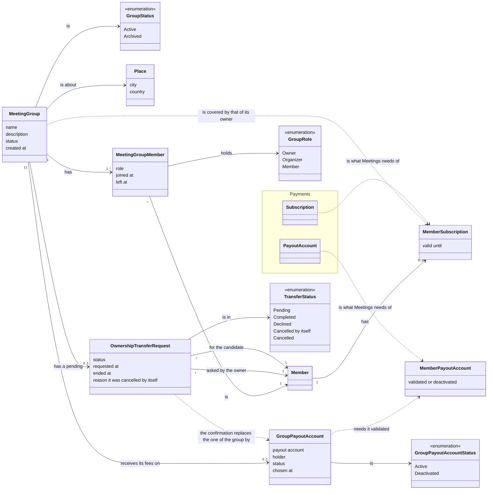

# Meetings: conceptual model of the life of a group

The things of the domain and how they relate, before any technical choice. The rules are described in [the life of a meeting group](group-life.md); the behaviour is in the [event storming](group-life-event-storming.md). The group's birth is in the [conceptual model of its creation](group-creation-conceptual-model.md).

## Reading it

- **Meeting Group** is the aggregate at the centre. It holds its members and the rules on their roles: joining, leaving, appointing, demoting and completing a hand-over all go through it, so that its rules always hold, among them exactly one owner. A group has at most one pending transfer request at a time, which is kept beside it.
- **Meeting Group Member** links a member to a group, with a role and the dates they joined and left. A member who left no longer counts, and can join again as a new member.
- **Group Status** is active, or archived when the owner's account was deleted without a hand-over. Archiving is final and freezes the group: nothing changes in it and nobody joins it, but its members read it and can leave it, and its owner stays its owner.
- **Group Role** has three values. Exactly one member of a group is the owner at any time.
- **Ownership Transfer Request** exists to hand the group over. It knows the owner who asked and the candidate. Its confirmation by the candidate **completes it at once**, and its status becomes completed: it needs a valid subscription and, when a meeting with a fee has yet to start, a validated payout account, both checked at that moment. While it is pending, sign-ups to the group's meetings that have a fee are closed. A declined or cancelled request ends the same way, with its date. A request is cancelled by itself when its candidate leaves, is demoted or is locked by a pending deletion of their user account, and keeps which of the three it was.
- **Group Payout Account** is the payout account chosen by the owner of the group to receive its fees: one at most, with the payout account it names and its holder. It is **active** while that payout account is validated and **deactivated** while it is deactivated in Payments, which is the only way it becomes deactivated, and it is reactivated only by the reactivation of that payout account. It belongs to the group: only the owner of the group chooses it, which replaces the earlier one, and removes it, which needs that no meeting with a fee has yet to start. A confirmed transfer deletes the former owner's and puts the candidate's in its place.
- **Member Payout Account** is what Meetings needs to know of a payout account of a member: whether it is validated, and when it is deactivated or reactivated, as it is known from [Payments](../payments/meeting-fees.md#the-payout-account), see [what Meetings needs from other contexts](description.md#what-meetings-needs-from-other-contexts).
- **Member Subscription** is what Meetings needs to know of a member's subscription: until when it is valid, and whether they ever held one. The group is **covered** if its owner's subscription is valid, and the group has no date of its own. This date is what decides whether a meeting can be organized: Meetings needs no other fact about the end of a subscription, so nothing that arrives late can make the rule wrong.

## Rules that cross aggregates

- **The free plan.** A member who never held a subscription owns at most one group. The rule needs to know whether the member ever held a subscription and which groups they own, so a domain service checks it, at the acceptance of a proposal and not at the creation of the group, which is a reaction; the rule is absolute: when two proposals of the same member are accepted at the same moment, only one is accepted.
- **A hand-over and the payments.** A transfer can be requested only when no payment of the group's meetings waits. From the request until the transfer ends, the sign-ups to the meetings with a fee are closed. The rule reads the meetings of the group, so a domain service checks it; it is absolute: when a sign-up and the request happen at the same moment, one of them is refused, so that no payment waits once the request is made: either the sign-up is taken first and the request is refused, or the request is taken first and the sign-up is refused as closed.
- **The confirmation of a transfer.** It reads the candidate's subscription, as [Accounts](../accounts/description.md#the-subscription) knows it, the validity of the chosen payout account, as Meetings knows it, and the meetings of the group, to know whether one with a fee has yet to start. A domain service checks it, in the same transaction as the change of owner, so that the confirmation and a cancellation of the same request never both succeed.
- **Removing the group payout account.** It needs that no meeting of the group has a fee and has yet to start. The rule reads the meetings of the group, so a domain service checks it, with the group as scope; it is absolute: a removal and the setting of a fee on a meeting of the group never both succeed. The deactivation of a payout account in Payments, which deactivates the group payout accounts that name it, is not a command of the owner of the group and is not refused.
- **The last host.** A member cannot leave a group while they are the last host of a meeting that has not started. The rule reads the meetings of the group, so a domain service checks it; the rule is absolute: when the last two hosts leave at the same moment, only one succeeds.
- **A locked candidate.** A locked member cannot be designated as a candidate, and a pending request whose candidate becomes locked is cancelled by itself. When the two requests arrive at the same moment, the first wins: a deletion request that comes second cancels the hand-over, and a hand-over request that comes second is refused.

## What is not in the model

- No limit of groups per subscription.
- No history of the owners beyond the completed transfer requests.
- No link between a completed transfer and the former owner's subscription: it stays theirs, in Payments.
