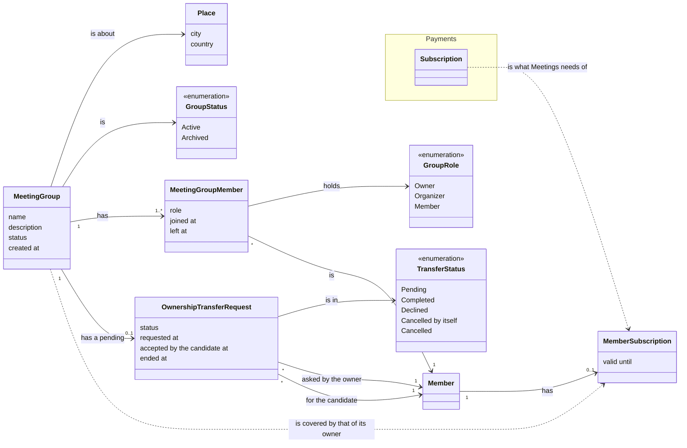

# Meetings: conceptual model of the life of a group

The things of the domain and how they relate, before any technical choice. The rules are described in [the life of a meeting group](group-life.md); the behaviour is in the [event storming](group-life-event-storming.md). The group's birth is in the [conceptual model of its creation](group-creation-conceptual-model.md).

## Reading it

- **Meeting Group** is the aggregate at the centre. It holds its members and the rules on their roles: joining, leaving, appointing, demoting and completing a hand-over all go through it, so that its rules always hold, among them exactly one owner. A group has at most one pending transfer request at a time, which is kept beside it.
- **Meeting Group Member** links a member to a group, with a role and the dates they joined and left. A member who left no longer counts, and can join again as a new member.
- **Group Status** is active, or archived when the owner's account was deleted without a hand-over. Archiving is final and freezes the group: nothing changes in it and nobody joins it, but its members read it and can leave it, and its owner stays its owner.
- **Group Role** has three values. Exactly one member of a group is the owner at any time.
- **Ownership Transfer Request** exists to hand the group over. It knows the owner who asked and the candidate. It records the moment the candidate accepted, which is not yet the end: the request completes only once the candidate's subscription is known to be valid, and its status then becomes completed. While it is pending, sign-ups to the group's meetings that have a fee are closed. A declined or cancelled request ends the same way, with its date. A request is cancelled by itself when its candidate leaves, is demoted or is locked by a pending deletion of their account.
- **Member Subscription** is what Meetings needs to know of a member's subscription: until when it is valid, and whether they ever held one. The group is **covered** if its owner's subscription is valid, and the group has no date of its own. This date is what decides whether a meeting can be organized: Meetings needs no other fact about the end of a subscription, so nothing that arrives late can make the rule wrong.

## Rules that cross aggregates

- **The free plan.** A member who never held a subscription owns at most one group. The rule needs to know whether the member ever held a subscription and which groups they own, so a domain service checks it, at the acceptance of a proposal and not at the creation of the group, which is a reaction; the rule is absolute: when two proposals of the same member are accepted at the same moment, only one is accepted.
- **A hand-over and the payments.** A transfer can be requested only when no payment of the group's meetings waits, and a candidate's acceptance counts only if their payout account is validated when a meeting with a fee has yet to start. From the acceptance until the transfer ends, that account cannot be removed: an acceptance and a removal at the same moment do not both succeed. The rule reads the meetings of the group and the account as [Meetings knows it](organization-conceptual-model.md), so a domain service checks it; the rule is absolute: when a sign-up and the request happen at the same moment, one of them is refused, so that no payment waits once the request is accepted: either the sign-up is taken first and the request is refused, or the request is taken first and the sign-up is refused as closed.
- **The last host.** A member cannot leave a group while they are the last host of a meeting that has not started. The rule reads the meetings of the group, so a domain service checks it; the rule is absolute: when the last two hosts leave at the same moment, only one succeeds.
- **A locked candidate.** A locked member cannot be designated as a candidate, and a pending request whose candidate becomes locked is cancelled by itself. When the two requests arrive at the same moment, the first wins: a deletion request that comes second cancels the hand-over, and a hand-over request that comes second is refused.

## What is not in the model

- No limit of groups per subscription.
- No history of the owners beyond the completed transfer requests.
- No link between a completed transfer and the former owner's subscription: it stays theirs, in Payments.
