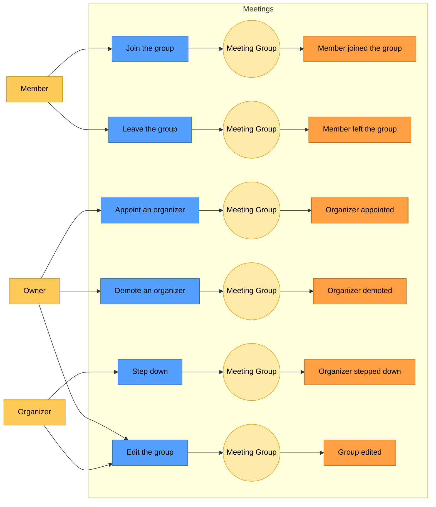
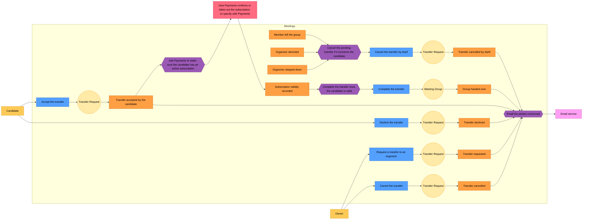
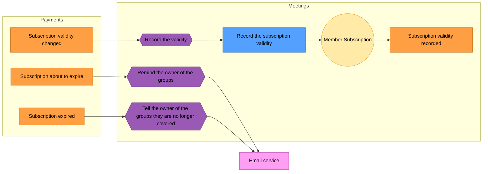
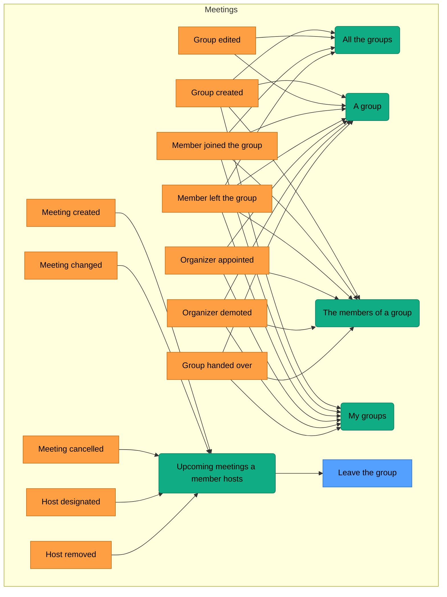

# Meetings: event storming of the life of a group

Event storming lays out a process as a sequence of **commands** (what someone asks), **aggregates** (what decides), **events** (what happened) and **policies** (what the system does in reaction). The [conceptual model](group-life-conceptual-model.md) shows the structure; this page shows the behaviour described in [the life of a meeting group](group-life.md). It has three parts: the members and their roles, the hand-over of the group, and the coverage by the subscription.

## Members and roles

Blue is a command, pale yellow an aggregate, orange an event, darker yellow someone who asks for a command.

1. **Joining.** A member joins, once. Joining again after leaving is a new membership.
2. **Leaving.** A member or an organizer leaves. The command is refused for the owner, who hands the group over first, and for the last host of a meeting that has not started, who has another host designated first. What leaving changes in the meetings is in the [event storming of organizing meetings](organization-event-storming.md#the-group-and-payments).
3. **Appointing.** Only the owner appoints, and only a member of the group who is not an organizer yet.
4. **Demoting and stepping down.** Only the owner demotes an organizer, and an organizer demotes only themselves. The owner can do neither to themselves.
5. **Editing.** The owner or an organizer edits the name, the description or the place.

## Handing the group over

Blue is a command, pale yellow an aggregate, orange an event, purple a policy, darker yellow someone who asks for a command, red a point left open, pink an external system.

1. **The request.** The owner designates an organizer. One request is pending at most for a group, and it has no deadline.
2. **Accepting.** The candidate's acceptance does not complete the transfer: it asks Payments to make sure the candidate has an active subscription. The request stays pending.
3. **Completing.** The transfer completes only when Meetings records that the candidate's subscription is valid, as announced by Payments. The candidate becomes the owner, the former owner becomes an organizer, and the group follows the new owner's subscription.
4. **Ending.** The candidate can decline, the owner can cancel, and the request is cancelled by itself if the candidate leaves or is demoted. A completed transfer is final.
5. **Emails.** Every event of the request sends an email to each party concerned.
6. **The open point.** How Payments checks, or takes out, the subscription is specified in the Payments documentation. This page only needs its answer: the subscription of the candidate is valid.

## Covering the group

Blue is a command, pale yellow an aggregate, orange an event, purple a policy, pink an external system.

1. **Recording.** When Payments announces a new validity, Meetings records it for the member. This is the date that decides whether a meeting can be organized, and it is what completes a transfer.
2. **Reminding.** When Payments announces that a subscription is about to expire, an email reminds the owner of each group they own.
3. **Expiring.** When it has expired, an email tells the owner that their group is no longer covered. Nothing else changes: the group can no longer organize new meetings, and the meetings already planned stay.

## Reading

Blue is a command, orange an event, green a read model.

1. **All the groups, a group.** Each is kept up to date by the events of the group: its creation, its edits, the members who join and leave, the organizers appointed and demoted, and a hand-over. The number of members comes from the same events.
2. **The members of a group, my groups.** Both come from the same events as the roles: joining, leaving, appointing, demoting and handing over.
3. **The upcoming meetings a member hosts.** It is kept up to date by the events of the meetings: a meeting is created, changed or cancelled, and a host is designated or removed. The command to leave the group reads it, and is refused if the member is the last host of one of these meetings. Two operations can happen together, a host leaving and the other host being removed, so this rule cannot be made absolute by the group alone: how the application deals with that is a technical choice.

The rest of the events come from [Payments](../payments/description.md): Meetings only listens to them.
