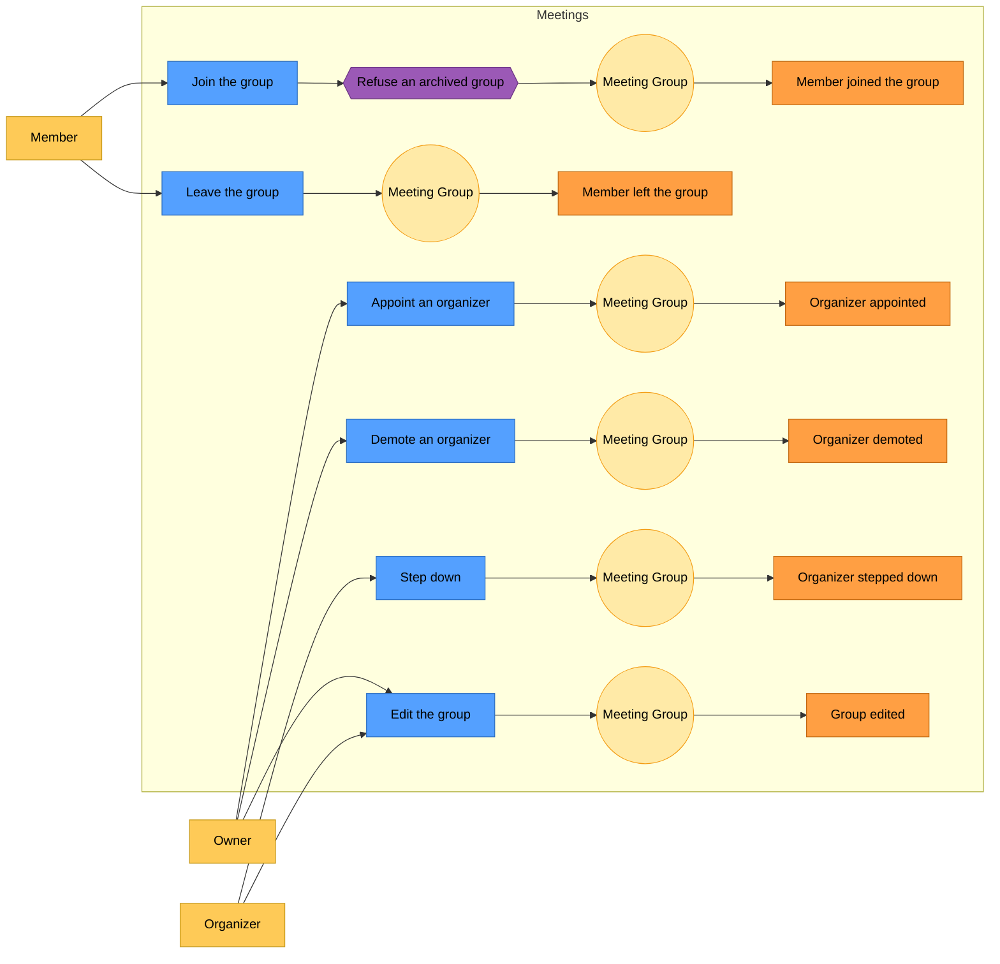
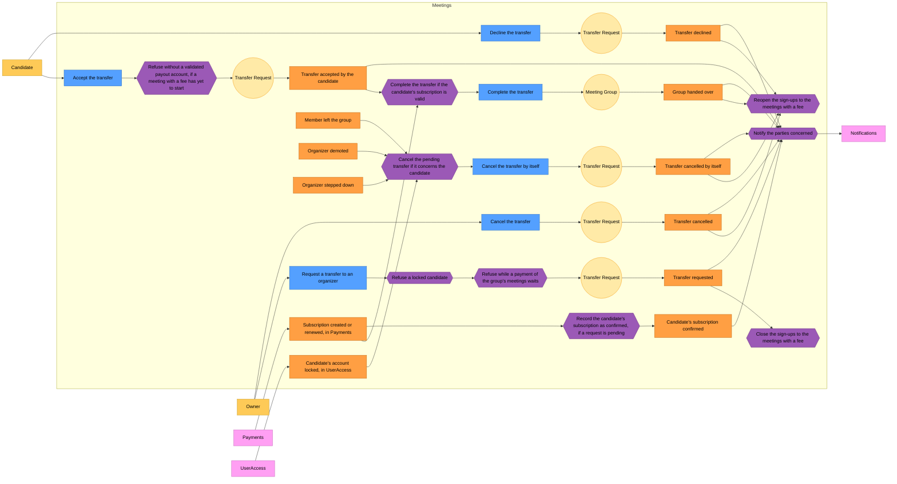
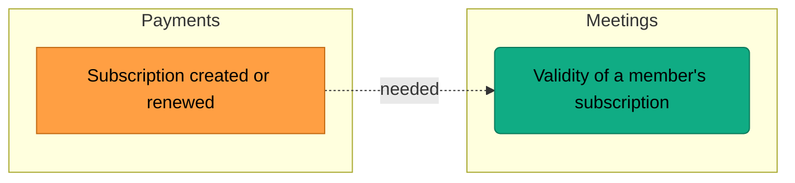
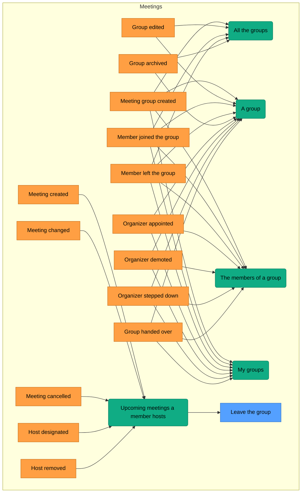

# Meetings: event storming of the life of a group

Event storming lays out a process as a sequence of **commands** (what someone asks), **aggregates** (what decides), **events** (what happened) and **policies** (what the system does in reaction). The [conceptual model](group-life-conceptual-model.md) shows the structure; this page shows the behaviour described in [the life of a meeting group](group-life.md). It has three parts: the members and their roles, the hand-over of the group, and the coverage by the subscription.

## Members and roles

Blue is a command, pale yellow an aggregate, orange an event, purple a policy, darker yellow someone who asks for a command.

1. **Joining.** A member joins, once, and not an [archived group](group-life.md#archived-groups). Joining again after leaving is a new membership.
2. **Leaving.** A member or an organizer leaves, an archived group included. The command is refused for the owner, who hands the group over first, and for the last host of a meeting that has not started, who has another host designated first. The refusal is absolute: when the last two hosts leave at the same moment, only one succeeds. What leaving changes in the meetings is in the [event storming of organizing meetings](organization-event-storming.md#the-group-and-payments).
3. **Appointing.** Only the owner appoints, and only a member of the group who is not an organizer yet.
4. **Demoting and stepping down.** Only the owner demotes an organizer, and an organizer demotes only themselves. The owner can do neither to themselves.
5. **Editing.** The owner or an organizer edits the name, the description or the place, unless the group is archived.
6. **Archiving.** An archived group is frozen: every command of this page and of the other pages of Meetings that would change it is refused, except leaving. The group is archived in reaction to the deletion of its owner's account, see [deleting an account](../useraccess/account-deletion.md).

## Handing the group over

Blue is a command, pale yellow an aggregate, orange an event, purple a policy, darker yellow someone who asks for a command, pink an external system.

1. **The request.** The owner designates an organizer, who must not be locked: the designation is refused otherwise. When the owner's request and the candidate's deletion request arrive at the same moment, the first to arrive wins: a deletion request that comes second cancels the hand-over, and a hand-over request that comes second is refused. One request is pending at most for a group, and it has no deadline.
2. **Accepting.** A policy refuses the acceptance without a validated payout account when a meeting with a fee has yet to start. The acceptance does not complete the transfer. The candidate who has no active subscription takes one out, or renews, in Payments, like any payer, and the request stays pending.
3. **Completing.** The transfer completes when Meetings knows that the candidate's subscription is valid, either because it already was when they accepted, or because it became valid afterwards. The candidate becomes the owner, the former owner becomes an organizer, and the group follows the new owner's subscription.
4. **Ending.** The candidate can decline, the owner can cancel, and the request is cancelled by itself if the candidate leaves, is demoted or becomes locked by a pending deletion of their account. A completed transfer is final.
5. **Notifications.** Every event of the request, the confirmation of the candidate's subscription included, notifies the party concerned, as [the catalogue](../notifications/catalogue.md#meetings-groups) lists.
6. **The payments.** The request is refused while a payment of the group's meetings waits. From it until the transfer ends, whichever way, sign-ups to the meetings with a fee are closed, so no payment is created while the receiver of the fees may change. The two rules are absolute: when a sign-up to a meeting with a fee and the request happen at the same moment, not both succeed. The fees of the sign-ups to come go to the new owner's payout account.

## Covering the group

Orange is an event, green the information Meetings needs. A dotted arrow means that Meetings needs the fact.

1. **The validity.** Meetings needs to know until when a member's subscription is valid. This is the date that decides whether a meeting can be organized, and it is what completes a transfer.
2. **Expiring.** When the date has passed, the group is no longer covered. Nothing else changes: the group can no longer organize new meetings, and the meetings already planned stay. Meetings notifies nobody: [Payments](../payments/subscriptions.md#notifications) tells the owner, as the payer, that the subscription is about to expire and that it has expired.
3. **The free plan.** An owner of whom Meetings knows no validity at all has never held a subscription: they are on the [free plan](group-life.md#the-free-plan), with one group, always covered, and two meetings a month. The first subscription takes them off it for good.

## Reading

Blue is a command, orange an event, green a read model.

1. **All the groups, a group.** Each is kept up to date by the events of the group: its creation, its edits, the members who join and leave, the organizers appointed, demoted or stepped down, a hand-over, and its archiving, which both views show. The number of members comes from the same events.
2. **The members of a group, my groups.** Both come from the same events as the roles: joining, leaving, appointing, demoting, stepping down and handing over.
3. **The upcoming meetings a member hosts.** It is kept up to date by the events of the meetings: a meeting is created, changed or cancelled, and a host is designated or removed. The command to leave the group reads it, and is refused if the member is the last host of one of these meetings. The rule is absolute: a meeting never has no host. When two operations happen together, a host leaving and the other host being removed, or the last two hosts leaving, only one of them succeeds and the other is refused, as if it had come second.

The facts that come from [Payments](../payments/description.md) are the information Meetings needs, listed in [its description](description.md#what-meetings-needs-from-other-contexts).
