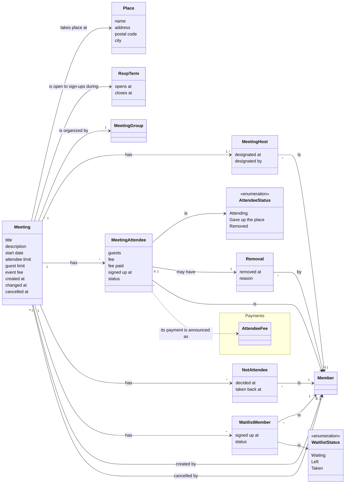

# Meetings: conceptual model of organizing meetings

The things of the domain and how they relate, before any technical choice. The rules are described in [organizing meetings](organization.md); the behaviour is in the [event storming](organization-event-storming.md). The group that organizes the meetings is in the [conceptual model of its life](group-life-conceptual-model.md).

## Reading it

- **Meeting** is the aggregate at the centre. It holds its hosts, its attendees, the members who said they will not come, and its waitlist, so that its rules always hold: the places taken against the limit, the order of the waitlist, at least one host. A meeting is created through its [meeting group](group-life-conceptual-model.md), which checks that it is covered and that the hosts are members. The meeting then reads the group's members and organizers to check who signs up and who may act.
- **Place** and **RSVP Term** are values of the meeting. The RSVP term has an optional opening and an optional closing, and never closes after the start.
- **Meeting Host** links a member to a meeting they are responsible for holding, with the date they were designated and by whom. A host is not an attendee: they take no place and owe no fee. A meeting always has at least one host, and a member is never a host and an attendee of the same meeting.
- **Meeting Attendee** links a member to a meeting, with a number of guests, the fee owed and whether it is paid, and the date of signing up. Its status says whether the member is still attending, gave up the place by saying they will not come, or was removed. A removed attendee keeps the date, the reason and who removed them, and cannot sign up again. The places taken by a meeting are those of its attending members and their guests.
- **Not Attendee** is a member's decision not to come. It is taken back when the member signs up or reverses it.
- **Waitlist Member** is a member waiting for a place, without guests. The longest-waiting member is the first to be taken. Leaving the waitlist or being taken ends the wait.
- **Meeting** also remembers when it was changed and by whom, and when and by whom it was cancelled. A cancelled meeting is frozen.
- **Attendee Fee** is what [Payments](../payments/description.md) knows of the debt: Meetings only keeps the amount owed and whether it is paid, as announced by Payments.

## What is not in the model

- No end date for a meeting.
- No history of a member's changes of decision, or of a host who stepped down, beyond the current state.
- No link between a removed attendee and the waitlist: a removal only frees places.
- Comments, replies and likes, which are in [commenting](commenting.md).
