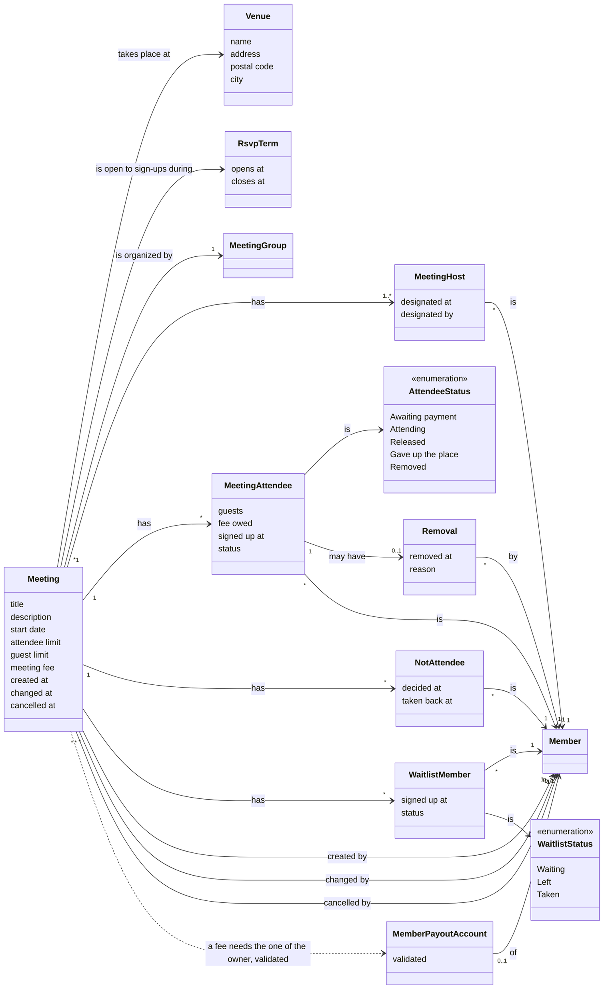

# Meetings: conceptual model of organizing meetings

The things of the domain and how they relate, before any technical choice. The rules are described in [organizing meetings](organization.md); the behaviour is in the [event storming](organization-event-storming.md). The group that organizes the meetings is in the [conceptual model of its life](group-life-conceptual-model.md).

## Reading it

- **Meeting** is the aggregate at the centre. It holds its hosts, its attendees, the members who said they will not come, and its waitlist, so that its rules always hold: the places taken against the limit, the order of the waitlist, at least one host. A meeting is created through its [meeting group](group-life-conceptual-model.md), which checks that it is covered and that the hosts are members. The meeting then reads the group's members and organizers to check who signs up and who may act.
- **Venue** and **RSVP Term** are values of the meeting. The RSVP term has an optional opening and an optional closing, and never closes after the start.
- **Meeting Host** links a member to a meeting they are responsible for holding, with the date they were designated and by whom. A host is not an attendee: they take no place and owe no fee. A meeting always has at least one host, and a member is never a host and an attendee of the same meeting.
- **Meeting Attendee** links a member to a meeting, with a number of guests, the fee owed and the date of signing up. Its status says whether the member is **awaiting payment**, **attending** (confirmed, or with nothing to pay), **released** because the payment expired, gave up the place by saying they will not come, or was removed. A meeting without a fee has no awaiting or released status: the member is attending at once. A removed attendee keeps the date, the reason and who removed them, and cannot sign up again. The places taken by a meeting are those of its attending and awaiting members and their guests.
- **Not Attendee** is a member's decision not to come. It is taken back when the member signs up or reverses it.
- **Waitlist Member** is a member waiting for a place, without guests. Only a meeting without a fee has a waitlist. The longest-waiting member is the first to be taken. Leaving the waitlist or being taken ends the wait.
- **Meeting** also remembers when it was changed (**changed at**) and by whom (**changed by**, the member who made the last change), and when and by whom it was cancelled. A cancelled meeting is frozen, and so is a meeting of an [archived group](group-life-conceptual-model.md).
- **Member Payout Account** is what Meetings needs to know of the payout account of an owner: only whether it is validated, see [what Meetings needs from other contexts](description.md#what-meetings-needs-from-other-contexts). A fee can be set on a meeting only when the owner of its group has a validated one. Meetings holds no payment: it keeps the amount owed and the status of the place, and Payments keeps the payment.

## Rules that cross aggregates

- **Two meetings a month on the free plan.** A group on the [free plan](group-life.md#the-free-plan) can have at most two meetings, not cancelled, starting in the same month. The rule involves the group and its meetings, so a domain service checks it when a meeting is created or its start date changes, reading what is stored; the rule is absolute: when two meetings are created at the same moment, the third of the month is refused.
- **The last host.** A member cannot leave the group while they are the last host of a meeting that has not started. The rule involves the group and its meetings, so a domain service checks it; the rule is absolute: when the last two hosts leave at the same moment, only one succeeds and the other is refused.
- **A sign-up to a meeting with a fee and a hand-over.** Sign-ups to a meeting with a fee are closed from a hand-over request, and the request is refused while a payment waits; the rule is absolute: when a sign-up and the request happen at the same moment, not both succeed, see [the conceptual model of the life of a group](group-life-conceptual-model.md#rules-that-cross-aggregates). The same holds while the owner of the group is locked by a pending deletion of their account: sign-ups to its meetings with a fee are closed until that request ends, and a sign-up and the deletion request at the same moment do not both succeed.
- **A fee needs a validated payout account.** Setting a fee reads the owner's account as Meetings knows it. A meeting with a fee also has no waitlist, so setting a fee is refused while members wait.

## What is not in the model

- No end date for a meeting.
- No history of a member's changes of decision, or of a host who stepped down, beyond the current state.
- No link between a removed attendee and the waitlist: a removal only frees places.
- No payment, no payment system and no refund: those are Payments'.
- Comments, replies and likes, which are in [commenting](commenting.md).
