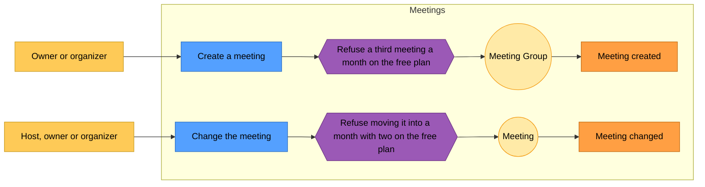
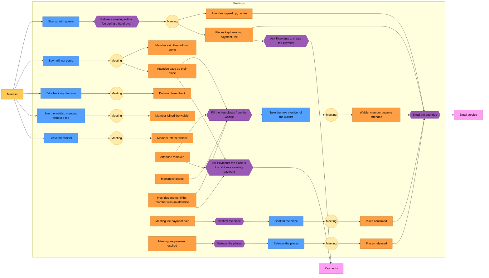
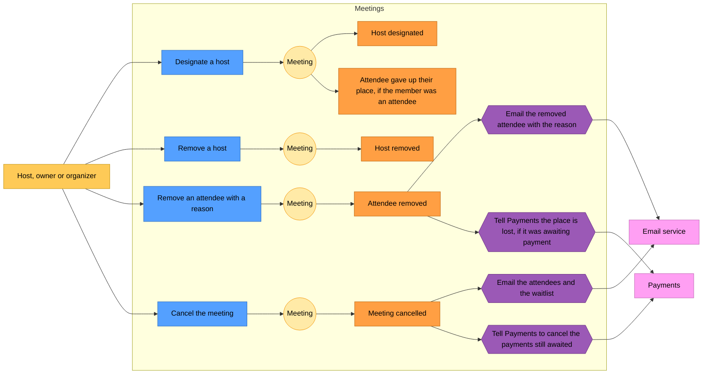
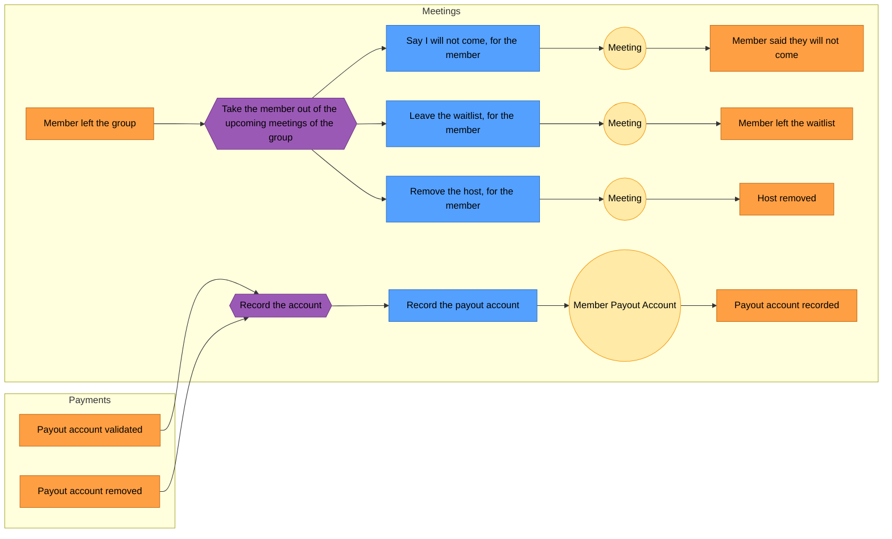
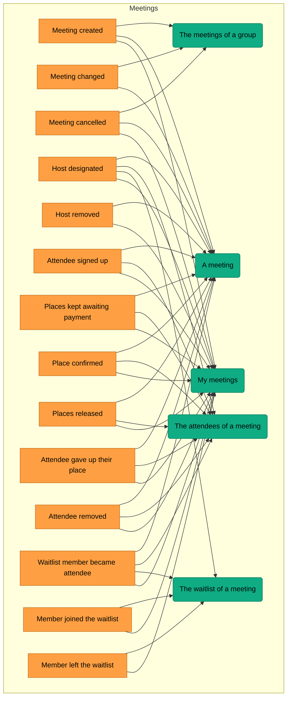

# Meetings: event storming of organizing meetings

Event storming lays out a process as a sequence of **commands** (what someone asks), **aggregates** (what decides), **events** (what happened) and **policies** (what the system does in reaction). The [conceptual model](organization-conceptual-model.md) shows the structure; this page shows the behaviour described in [organizing meetings](organization.md). It has four parts: creating and changing a meeting, attending it and the waitlist, looking after it, and the links with the group and with Payments.

## Creating and changing a meeting

Blue is a command, pale yellow an aggregate, orange an event, purple a policy, darker yellow someone who asks for a command.

1. **Creating.** The command goes through the meeting group, which refuses it unless the group is covered and the hosts are members of the group. With no host chosen, the creator is the host. The hosts are recorded as the meeting is created. For a group on the [free plan](group-life.md#the-free-plan), a policy also refuses a meeting when two others, not cancelled, already start in the same month.
2. **Changing.** Any of the meeting's attributes can change, as long as the attendee limit does not drop below the places taken. On the free plan, moving the start date into a month that already holds two meetings is refused. The meeting remembers who changed it and when. A change can free places, which is handled in the next part.

## Attending and the waitlist

Blue is a command, pale yellow an aggregate, orange an event, purple a policy, darker yellow someone who asks for a command, pink an external system.

1. **Signing up.** The meeting refuses unless the RSVP term is open, the member is in the group, is neither a host nor an attendee and was not removed, the guests are within the limit, enough places are left and no payment is awaited from them for this meeting. For a meeting with a fee, a policy also refuses it while the group is in a hand-over. A member who had said they will not come changes their mind.
2. **Without a fee.** The member becomes an attendee at once and gets an email.
3. **With a fee.** The places are kept, awaiting payment. An email tells the member the places and the time they are kept, and Payments is asked to create the payment for the amount owed.
4. **Paid or expired.** When Payments announces the payment paid, the place is confirmed and the attendee is told. When it announces it expired, the places are released and the member is told. A released meeting with a fee has no waitlist to fill, so nothing else follows: the next member to sign up takes the places.
5. **Saying they will not come.** The decision is recorded. If the member was an attendee, awaiting payment or not, they also give up their place and their guests'. A payment still awaited is cancelled by telling Payments.
6. **Taking back.** The member reverses their decision, and is neither attending nor not attending.
7. **The waitlist.** Only a meeting without a fee has one. A member joins it only when the meeting is full, without guests, and leaves it whenever they want.
8. **Filling the free places.** Places become free when an attendee gives up their place, is removed, becomes a host, or the attendee limit is raised. For a meeting with a waitlist, the policy takes the member waiting for the longest, one place each, and repeats while there are places and members waiting. The taken member keeps their sign-up date.
9. **Losing the place before paying.** When an attendee gives up the place, is removed or becomes a host while the payment is awaited, Meetings tells Payments, which cancels it.

## Looking after the meeting

Blue is a command, pale yellow an aggregate, orange an event, purple a policy, darker yellow someone who asks for a command, pink an external system.

1. **Hosts.** Any member of the group can be designated. A member who was an attendee stops being one, which frees their places for the waitlist, and a member who was waiting leaves the waitlist. Removing the last host is refused: another one is designated first.
2. **Removing an attendee.** The reason is mandatory, the places are freed for the waitlist, and the removed member cannot sign up again.
3. **Cancelling.** The meeting remembers who cancelled and when, and is then frozen. The cancellation is final. Meetings tells Payments, which cancels every payment of the meeting that still waits. A fee already paid is not refunded.
4. **Emails.** The removed attendee is told with the reason, and the attendees and the waitlist are told of a cancellation.

## The group and Payments

Blue is a command, pale yellow an aggregate, orange an event, purple a policy.

1. **Leaving the group.** The group's event is the trigger. On each meeting of the group that has not started, the member is treated as if they said they will not come, or they leave the waitlist, or they stop being a host. The freed places go to the waitlist of a meeting that has one, as in [attending](#attending-and-the-waitlist), and a payment still awaited is cancelled.
2. **The last host.** The group refuses the departure of a member who is the last host of a meeting that has not started, so this policy never leaves a meeting without a host. Another host must be designated first.
3. **The payout account.** Meetings records whether the owner's payout account is validated, as Payments announces it, and a fee can be set on a meeting only when it is. The paid and expired payments are handled in [attending](#attending-and-the-waitlist).

## Reading

Orange is an event, green a read model.

1. **The meetings of a group, a meeting.** Both follow the meeting's life: its creation, its changes, its cancellation, its hosts, and the attendees who sign up, wait for payment, are confirmed or released, give up their place, are removed or are taken from the waitlist. The places left come from the same events.
2. **The attendees, the waitlist.** The attendees follow the same events, and show for a meeting with a fee whether each place is awaiting payment or confirmed. The waitlist follows the members who join, leave, are taken, or become hosts.
3. **My meetings.** It gathers, for each member, the meetings where they host, attend or wait.
4. **Who sees what.** The views do not change the meeting, so they raise no event of their own. Who is allowed to see each one is in [organizing meetings](organization.md#reading).

The rest of the events come from [Payments](../payments/description.md) and from [the life of the group](group-life-event-storming.md): Meetings only listens to them.
