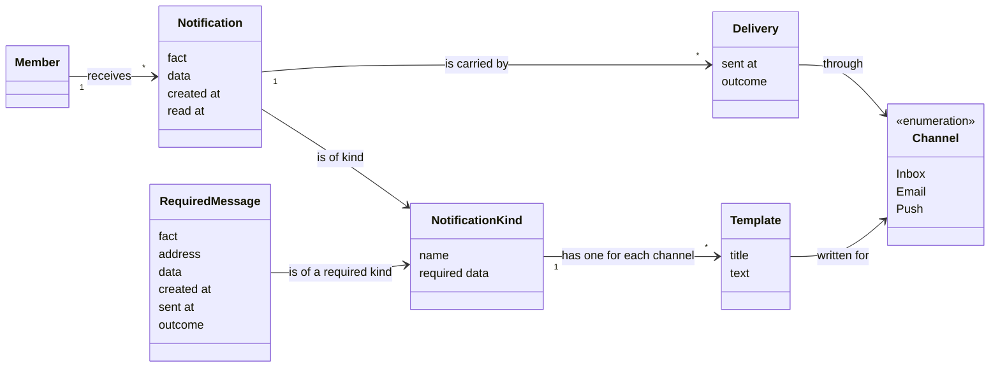

# Notifications: conceptual model

The things of the domain and how they relate, before any technical choice. The rules are described in [Notifications](description.md); the kinds are in [the catalogue](catalogue.md); the behaviour is in the [event storming](event-storming.md).

## Reading it

- **Notification** is an aggregate: what happened, seen by one member. Its **fact** says which fact of which context it comes from, and with the member it identifies it: a fact handed twice gives one notification. Its data is a snapshot of the moment. It is read or not, and the member is the only one who changes that.
- **Delivery** is an aggregate of its own, one for each notification and each channel other than the inbox. It records when the sending happened and how it ended. It is separate from the notification so that a member reading a notification and an email being sent never compete.
- **Required Message** is an aggregate: an email to an address, with its fact, its kind and data, and how its sending ended. It has no member, no inbox and nothing to read.
- **Notification Kind** and **Template** are not stored data: they are the [catalogue](catalogue.md), part of the application. A kind has the data it requires and one template for each channel it uses, a title and a text. The inbox is a channel with a template like the others, but it has no delivery: the notification itself is in the inbox.
- **Channel** has three values: *inbox*, *email* and *push*. Push is planned and out of scope for now.
- **Member** is known only by its identity. Notifications keeps no address: it needs the current one of the member when an email is sent.

## Rules that cross aggregates

- **One notification for each fact and member.** The rule involves every notification, so it is checked when one is created. It is absolute: when the same fact is handed twice at the same moment, only one notification exists.
- **A notification never outlives the erasure of its member.** When a member is erased, their notifications and their deliveries are deleted, and none is created for them afterwards. The rule is absolute, even when a creation and an erasure happen at the same moment.

## What is not in the model

- No preference of the member, no digest.
- No push yet: the channel exists, nothing sends through it.
- No editing of the catalogue, no language.
- No deletion of a notification by the member, and no time limit on keeping one.
- No record of whether an email was opened.
