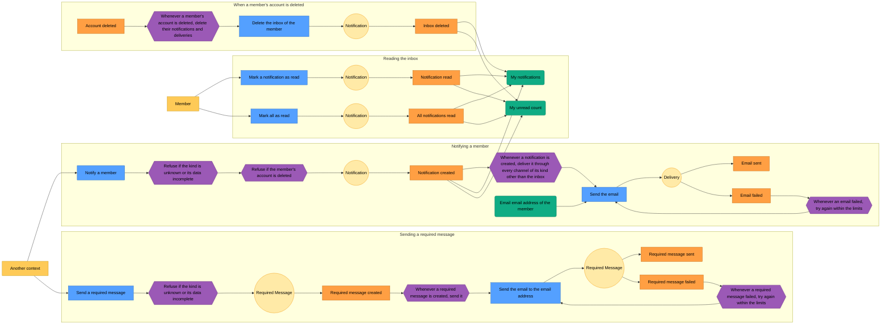

# Notifications: event storming

Event storming lays out a process as a sequence of **commands** (what someone asks), **aggregates** (what decides), **events** (what happened) and **policies** (what the system does in reaction). The [conceptual model](conceptual-model.md) shows the structure; this page shows the behaviour. The rules are in [Notifications](description.md).

Blue is a command, pale yellow an aggregate, orange an event, purple a policy, darker yellow someone who asks for a command, green a read model.

## Reading it

1. **Notifying.** Another context hands Notifications a fact for one member: its kind, its identity and its data. A policy first refuses a kind that is not in the [catalogue](catalogue.md) or data that is incomplete, and refuses a member whose account is deleted. A fact already handed for the same member changes nothing: there is still one notification. A context with several members to notify hands one fact for each.
2. **Delivering.** Once the notification exists, a policy sends it through each channel its kind uses besides the inbox, which today means the email. The email goes to the current email address of the member, which Notifications needs exact at that moment, as Accounts knows it. A failure is repeated within limits left to the implementation, and never removes the notification, which stays in the inbox.
3. **Required messages.** They follow the same path, without a member: the email address is given with the fact, nothing is stored in an inbox, and the only thing that can happen is that the email is sent or fails.
4. **Reading.** The member lists their notifications, most recent first, and counts the unread ones. Marking one as read, or all, does nothing when they are already read. Nobody but the member reads or marks their own.
5. **Erasing.** When a member's account is deleted, their notifications and their deliveries are deleted at once, and a notification arriving after that is refused. The required message that confirms the deletion goes to the email address, not to a member, and is not concerned.
