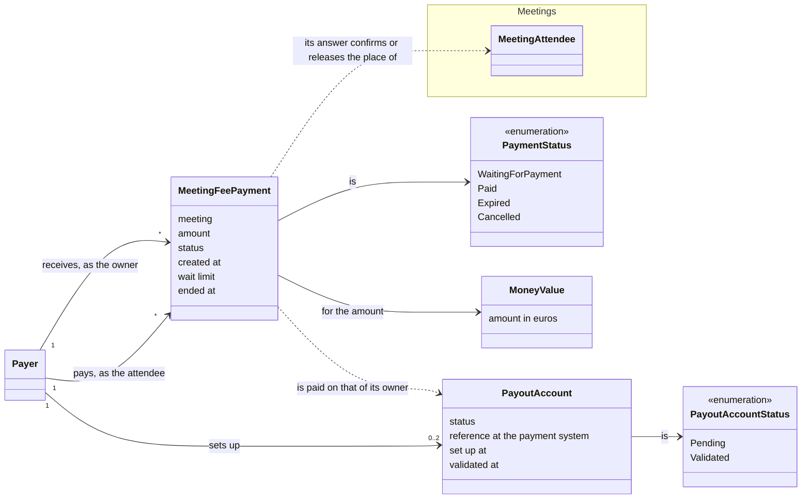

# Payments: conceptual model of meeting fees

The things of the domain and how they relate, before any technical choice. The rules are described in [meeting fees](meeting-fees.md); the behaviour is in the [event storming](meeting-fees-event-storming.md).

## Reading it

- **Meeting Fee Payment** is the aggregate at the centre. It knows the attendee who pays, the owner who receives, the meeting, the amount and the limit of its wait for the payment system. It decides its own end: paid when the payment system confirms, expired when the limit passes, or cancelled. Once ended, it never changes its status again, but it can record a payment that arrives after its end. Its owner is named by Meetings when it is created and never changes.
- **Payment Status** has four values. *Paid*, *expired* and *cancelled* are ends.
- **Payout Account** is where an owner receives fees. It holds the reference given by the payment system, and is **pending** until the payment system validates it, then **validated**. A payer has at most one validated account and one pending, which replaces it once validated. Only a validated account lets a meeting have a fee.
- **Money Value** is the same as in [subscriptions](subscriptions-conceptual-model.md): an amount in euros, never negative.
- **Meeting Attendee** is what [Meetings](../meetings/organization-conceptual-model.md) keeps of the place: the amount owed and its status, awaiting payment, attending or released, which follows what Payments announces.

## Rules that cross aggregates

- A member has **one payment waiting at most for a meeting**. The rule involves all the payments of the same attendee and meeting, so a domain service checks it, reading what is stored; the rule is absolute: when two payments for the same attendee and meeting are created at the same moment, only one is created.
- A payout account is removed only when no meeting that has a fee, of the groups of its owner, has yet to start. Payments asks Meetings at the moment of the removal, and keeps no copy.

## What is not in the model

- No refund, and no record of what the owner received: both belong to the owner's payment system.
- No debt that outlives the wait: a payment that expires leaves nothing behind.
- No link between a payment and a group: Payments knows the meeting and the owner, never the group.
- No copy of the attendee's name or email address.
