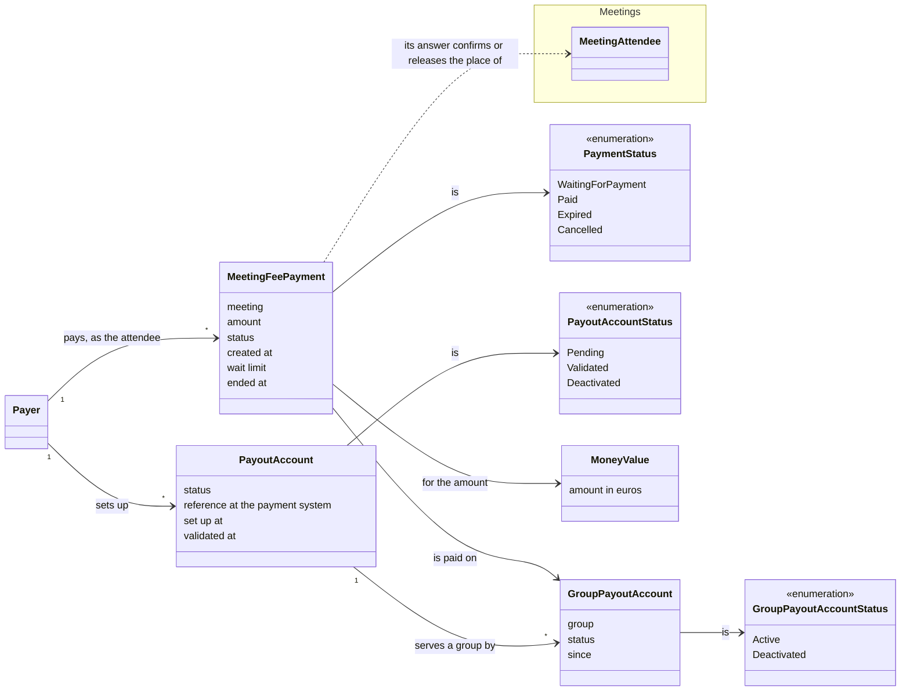

# Payments: conceptual model of meeting fees

The things of the domain and how they relate, before any technical choice. The rules are described in [meeting fees](meeting-fees.md); the behaviour is in the [event storming](meeting-fees-event-storming.md).

## Reading it

- **Meeting Fee Payment** is the aggregate at the centre. It knows the attendee who pays, the group payout account where the fee goes, the meeting, the amount and the limit of its wait for the payment system. It decides its own end: paid when the payment system confirms, expired when the limit passes, or cancelled. Once ended, it never changes its status again, but it can record a payment that arrives after its end. Its group payout account is named by Meetings when it is created and never changes.
- **Payment Status** has four values. *Paid*, *expired* and *cancelled* are ends.
- **Payout Account** is where a payer receives money. It holds the reference given by the payment system, and is **pending** until the payment system validates it, then **validated**. The payer can **deactivate** it and reactivate it, and it is never deleted. A payer can hold several, and each can serve one group or several. Only a validated account lets a meeting have a fee.
- **Group Payout Account** is a payout account chosen to receive the fees of one group, seen from Payments: the pair of the two, **active or deactivated**. [Meetings](../meetings/group-life-conceptual-model.md) decides it, and Payments keeps it so that a payment names where its fee goes. When Meetings removes it, the pair stays, deactivated, with the payments made for it.
- **Money Value** is the same as in [subscriptions](subscriptions-conceptual-model.md): an amount in euros, never negative.
- **Meeting Attendee** is what [Meetings](../meetings/organization-conceptual-model.md) keeps of the place: the amount owed and its status, awaiting payment, attending or released, which follows the payment.

## Rules that cross aggregates

- A member has **one payment waiting at most for a meeting**. The rule involves all the payments of the same attendee and meeting, so a domain service checks it, reading what is stored; the rule is absolute: when two payments for the same attendee and meeting are created at the same moment, only one is created.
- A payment is created only for a pair that is **active** and whose payout account is **validated**. The payout account and the payment are both in Payments, so the rule is absolute: when a deactivation of the payout account and the creation of a payment happen at the same moment, only one succeeds. The pair is decided in Meetings, which refuses the sign-up first.
- A payout account that is deactivated **cancels the payments waiting** on it. A payment already paid is left as it is.

## What is not in the model

- No refund, and no record of what the owner received: both belong to the owner's payment system.
- No debt that outlives the wait: a payment that expires leaves nothing behind.
- No other knowledge of the group than its group payout account: Payments does not know its owner, its meetings or its members.
- No name and no email address of the attendee: only their identity.
