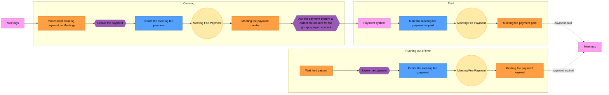
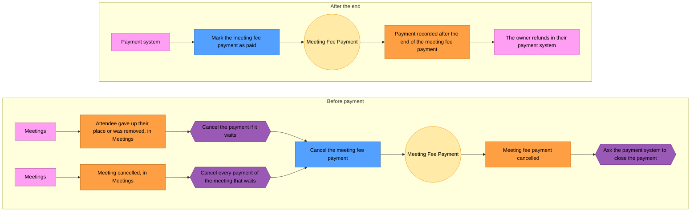
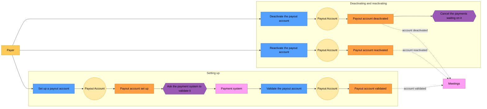
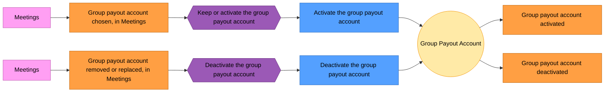

# Payments: event storming of meeting fees

Event storming lays out a process as a sequence of **commands** (what someone asks), **aggregates** (what decides), **events** (what happened) and **policies** (what the system does in reaction). The [conceptual model](meeting-fees-conceptual-model.md) shows the structure; this page shows the behaviour. The rules are in [meeting fees](meeting-fees.md).

## Paying for a place

Blue is a command, pale yellow an aggregate, orange an event, purple a policy, pink an external system.

### Reading it

1. **Creating.** Payments needs to know that an attendee is awaiting payment, with the amount and the group payout account where it goes. It refuses when that group payout account is deactivated or its payout account is not validated. Otherwise it creates the payment, waiting, with a limit 30 minutes later by default. A policy asks the [payment system](description.md#the-payment-system) to collect the amount for the payout account of the group, and the attendee pays on its page. Payments never takes the money itself.
2. **Paid.** The answer of the payment system marks the payment as paid. Meetings confirms the place once it knows the payment is paid, and not before.
3. **Running out of time.** Nobody asked: time did. The payment expires, and Meetings, which needs to know it, releases the places. The member signs up again if they still want to come.

## Cancelling

Blue is a command, pale yellow an aggregate, orange an event, purple a policy, pink an external system.

### Reading it

1. **Before paying.** An attendee loses the place by giving it up (they said they will not come, became a host or left the group) or by being removed. Whatever the reason, Payments needs to know it and the payment is cancelled if it still waits, and the payment system is asked to close it. A meeting cancelled cancels every payment of the meeting that waits, by the same command.
2. **After the end.** A payment can reach Payments after its end, because it was already with the payment system. The payment records it, its status and the place do not change, and a refund, if any, is the owner's, in their own payment system.
3. **Already paid.** A paid payment is left as it is when its attendee later loses the place or the meeting is cancelled. The application never refunds.

## The payout account

Blue is a command, pale yellow an aggregate, orange an event, purple a policy, darker yellow someone who asks for a command, pink an external system.

### Reading it

1. **Setting up.** The payer starts the setup, and the account is pending. A policy asks the payment system to validate it, which the payer completes with it.
2. **Validated.** The answer of the payment system validates the account, which Meetings needs to know. That is what lets an owner choose it for a group.
3. **Deactivating.** The payer deactivates the account whenever they want. The payments waiting on it are cancelled, and no payment is created for it afterwards. Meetings needs to know it, and deactivates the group payout accounts that name it, so that the sign-ups to the meetings with a fee of those groups stop. Payments never asks whether such a meeting exists: the holder decides, and the consequence is that nobody can sign up until they reactivate.
4. **Reactivating.** The holder reactivates it, the payments can be created again, and Meetings reactivates the group payout accounts that name it.

## The group payout account

Blue is a command, pale yellow an aggregate, orange an event, purple a policy, pink an external system.

### Reading it

1. **Chosen.** The owner chooses a validated payout account for the group in [Meetings](../meetings/group-life.md#the-payout-account-of-the-group), or the candidate does it at the confirmation of a hand-over. Payments needs to know it, and keeps the pair of the payout account and the group as an active group payout account. A pair already known is activated again.
2. **Removed or replaced.** The owner removes it, or a new choice or a transfer replaces it, in Meetings, which deletes it there. Payments needs to know it and keeps the pair as deactivated, with the payments made for it, which are never deleted. From then on, no payment is created for it.
