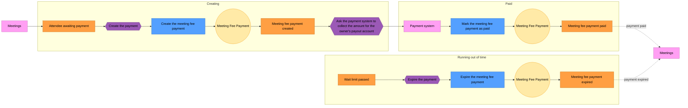
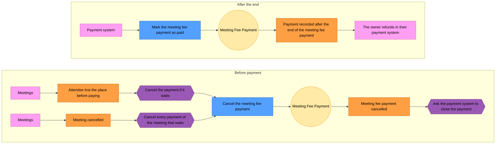
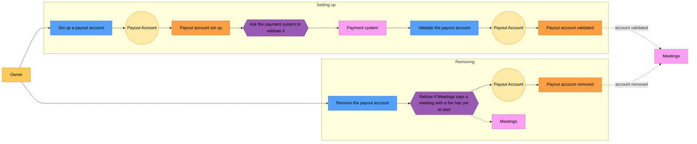

# Payments: event storming of meeting fees

Event storming lays out a process as a sequence of **commands** (what someone asks), **aggregates** (what decides), **events** (what happened) and **policies** (what the system does in reaction). The [conceptual model](meeting-fees-conceptual-model.md) shows the structure; this page shows the behaviour. The rules are in [meeting fees](meeting-fees.md).

## Paying for a place

Blue is a command, pale yellow an aggregate, orange an event, purple a policy, pink an external system.

### Reading it

1. **Creating.** When Meetings says that an attendee is awaiting payment, with the amount and the owner who receives it, Payments creates the payment, waiting, with a limit 30 minutes later by default. A policy asks the [payment system](description.md#the-payment-system) to collect the amount for the owner's payout account, and the attendee pays on its page. Payments never takes the money itself.
2. **Paid.** The answer of the payment system marks the payment as paid. Meetings confirms the place once it knows the payment is paid, and not before.
3. **Running out of time.** Nobody asked: time did. The payment expires, and Meetings, which needs to know it, releases the places. The member signs up again if they still want to come.

## Cancelling

Blue is a command, pale yellow an aggregate, orange an event, purple a policy, pink an external system.

### Reading it

1. **Before paying.** Whatever the reason, Payments needs to know it and the payment is cancelled if it still waits, and the payment system is asked to close it. A meeting cancelled cancels every payment of the meeting that waits, by the same command.
2. **After the end.** A payment can reach Payments after its end, because it was already with the payment system. The payment records it, its status and the place do not change, and a refund, if any, is the owner's, in their own payment system.
3. **Already paid.** A paid payment is left as it is when its attendee later loses the place or the meeting is cancelled. The application never refunds.

## The payout account

Blue is a command, pale yellow an aggregate, orange an event, purple a policy, darker yellow someone who asks for a command, pink an external system.

### Reading it

1. **Setting up.** The owner starts the setup, and the account is pending. A policy asks the payment system to validate it, which the owner completes with it.
2. **Validated.** The answer of the payment system validates the account, which Meetings needs to know. That is what lets the groups of the owner give a meeting a fee. When it replaces an earlier account, the new one takes over at that moment.
3. **Removing.** The owner removes the account. Payments needs to know whether a meeting that has a fee, of the owner's groups, has yet to start, and refuses if there is one. Meetings needs to know the removal, so that it stops accepting a fee for them.
