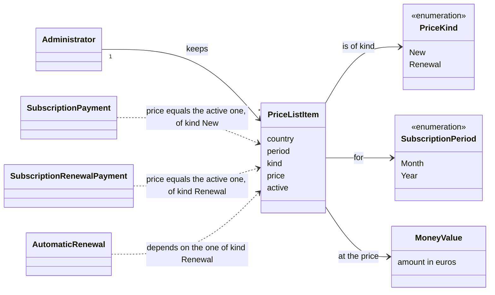

# Payments: conceptual model of the price list

The things of the domain and how they relate, before any technical choice. The rules are described in [the price list](price-list.md); the behaviour is in the [event storming](price-list-event-storming.md).

## Reading it

- **Price List Item** is the only aggregate. Its country, period and kind identify it and never change; its price and whether it is active do. It is never deleted.
- **Price Kind** has two values: *new* for a first purchase, *renewal* for any renewal, manual or automatic.
- **Subscription Period** is the one of [subscriptions](subscriptions-conceptual-model.md): a month or a year. A year has its own item, so a longer period can be cheaper.
- **Money Value** is an amount in euros, never negative. There is no other currency and no conversion.
- **Payments and automatic renewals** do not own items. A payment is created only if its price equals the active price of the item with the same country, period and kind, and an automatic renewal depends on the renewal item of its country and period, which is what makes a change of price concern it.

## Rules that cross aggregates

- **One active item per country, period and kind.** The rule involves every item, so a domain service checks it when an item is created or activated, reading what is stored. The rare race of two administrators acting at the same instant is left to a technical choice.

## What is not in the model

- No currency per item, and no conversion.
- No promotion, no discount code, no special rate.
- No history of past prices beyond those kept by the payments that used them.
- No deletion of an item.
