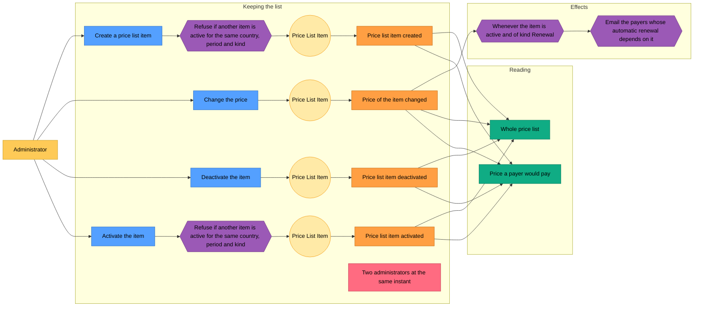

# Payments: event storming of the price list

Event storming lays out a process as a sequence of **commands** (what someone asks), **aggregates** (what decides), **events** (what happened) and **policies** (what the system does in reaction). The [conceptual model](price-list-conceptual-model.md) shows the structure; this page shows the behaviour. The rules are in [the price list](price-list.md).

Blue is a command, pale yellow an aggregate, orange an event, purple a policy, darker yellow someone who asks for a command, green a read model, red an open question.

## Reading it

1. **Creating.** The item is created active. A policy first checks that no other item is active for the same country, period and kind. The race of two administrators is a hotspot left to a technical choice.
2. **Changing the price.** Only the price changes, never the country, the period or the kind.
3. **Deactivating and activating.** Both do nothing when the item is already in that state. Activating is refused when another item is active for the same triple.
4. **The email.** It follows a change of price only when the item is active and of the kind *renewal*. It goes to the payers whose [automatic renewal](subscriptions-event-storming.md#automatic-renewal) has the same country and the same period. Nothing goes out for the other events.
5. **Reading.** The administrator reads the whole list. A payer reads only the price they would pay, which comes from the active item, and sees that no price is offered when there is none.
