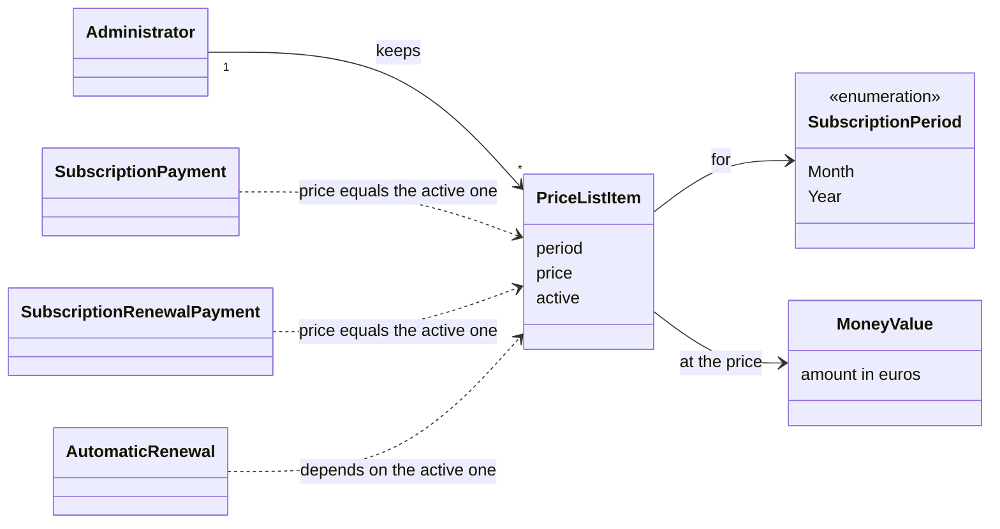

# Payments: conceptual model of the price list

The things of the domain and how they relate, before any technical choice. The rules are described in [the price list](description.md); the behaviour is in the [event storming](event-storming.md).

## Reading it

- **Price List Item** is the only aggregate. Its period says what it is the price of and never changes; its price and whether it is active do. It is never deleted. Its price is the same for every payer, whatever their country, for a first purchase and for a renewal.
- **Subscription Period** is the one of [subscriptions](../subscriptions/conceptual-model.md): a month or a year. A year has its own item, so a longer period can be cheaper.
- **Money Value** is an amount in euros, never negative. There is no other currency and no conversion.
- **Payments and automatic renewals** do not own items. A payment is created only if its price equals the active price of the item of the same period, and an automatic renewal, a trial not yet paid included, depends on the active item of its period. That is what makes a change of price concern it.

## Rules that cross aggregates

- **One active item per period.** The rule involves every item, so a domain service checks it when an item is created or activated, reading what is stored. The rule is absolute: when two administrators act at the same moment, only one succeeds.

## What is not in the model

- No country, no currency per item, and no conversion.
- No promotion, no discount code, no special rate.
- No history of past prices beyond those kept by the payments that used them.
- No deletion of an item.
