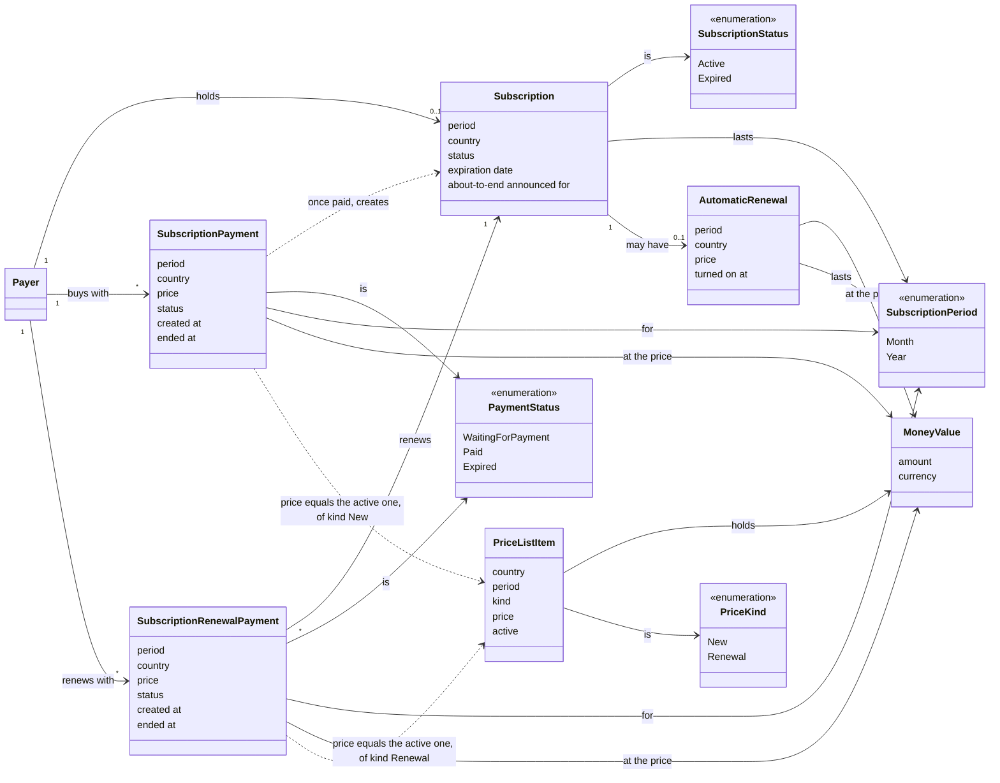

# Payments: conceptual model of subscriptions

The things of the domain and how they relate, before any technical choice. The rules are described in [subscriptions](subscriptions.md); the behaviour is in the [event storming](subscriptions-event-storming.md).

## Reading it

- **Payer** holds at most one subscription, and any number of payments over time. It is known only by its identity.
- **Subscription** is the aggregate at the centre. It holds its period, its country, its status and its expiration date, and the rules of its life: renewing, expiring, turning automatic renewal on and off. It remembers the expiration date for which it announced that it was about to end, so that the announcement is made once for each date. A subscription is created only from a paid subscription payment, never on its own.
- **Automatic Renewal** is part of a subscription, present only while the option is on. It keeps the period, the country and the price fixed when the option was turned on, which are those of the next automatic payment. It has no life of its own.
- **Subscription Payment** and **Subscription Renewal Payment** are two aggregates of the same shape: a purchase and the renewal of an existing subscription. Each holds the period, the country and the price at which it was created, and waits for the payment system. It ends as paid or expired and never changes after. The renewal payment knows the subscription it renews, the purchase has none yet.
- **Payment Status** has three values, the same for both payments. A payment leaves *waiting for payment* only once, to *paid* or to *expired*.
- **Subscription Period** has two values, a month and a year. The set is fixed, and a renewal may use another period than the one before.
- **Money Value** is an amount, never negative, and its currency.
- **Price List Item** is described in [the price list](price-list.md). It is shown here because a payment is created only if its price equals the active price of the item for the same country, period and kind: *new* for a purchase, *renewal* for a renewal.

## Rules that cross aggregates

- A payer has **one payment waiting at a time**, purchase or renewal, and one subscription at most. Each rule involves several aggregates, so a domain service checks it, reading what is stored; the rare race of two payments created at the same instant is left to a technical choice.
- An automatic renewal paid is not a payment created by the payer: it enters through the payment system's announcement, and renews the subscription like a paid renewal payment.

## What is not in the model

- No history of the periods of a subscription beyond its payments.
- No credit and no refund.
- No limit of groups per subscription.
- No copy of the payer's name or email address.
