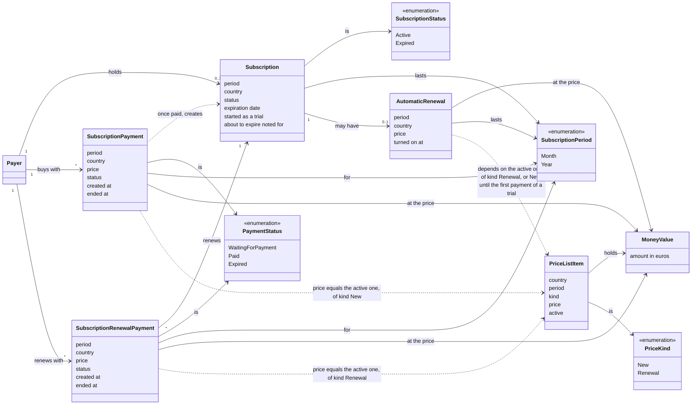

# Payments: conceptual model of subscriptions

The things of the domain and how they relate, before any technical choice. The rules are described in [subscriptions](subscriptions.md); the behaviour is in the [event storming](subscriptions-event-storming.md).

## Reading it

- **Payer** holds at most one subscription, and any number of payments over time. It is known only by its identity.
- **Subscription** is the aggregate at the centre. It holds its period, its country, its status and its expiration date, and the rules of its life: renewing, expiring, turning automatic renewal on and off. It remembers the expiration date for which it was noted as about to expire, so that this happens once for each date. A subscription is created only from a paid subscription payment or by starting a trial, never on its own.
- **Automatic Renewal** is part of a subscription, present only while the option is on. It keeps the period and the country fixed when the option was turned on, and the price of the next automatic payment, which follows the price list: the active *renewal* price once the subscription has been paid, or, for a trial that has not yet been paid, the active *new* price of the country and period of the trial. A change of the price of the matching active item replaces it, a deactivation does not. It has no life of its own. Changing its period while the subscription is active changes only what the next payment will be: the current period of the subscription is untouched, and nothing is credited or refunded.
- **Trial.** A subscription that started as a trial is an ordinary subscription whose first expiration date is 7 days after its creation and whose automatic renewal is on from the start. It remembers that it started as one, which is all that tells a trial from a purchase. A trial has no payment of its own: the first payment is the first period paid by the payment system, at the active *new* price at that moment. Until then its automatic renewal depends on the *new* item; afterwards, like any other, on the *renewal* item.
- **Subscription Payment** and **Subscription Renewal Payment** are two aggregates of the same shape: a purchase and the renewal of an existing subscription. Each holds the period, the country and the price at which it was created, and waits for the payment system. It ends as paid or expired and never changes after. The renewal payment knows the subscription it renews, the purchase has none yet.
- **Payment Status** has three values, the same for both payments. A payment leaves *waiting for payment* only once, to *paid* or to *expired*.
- **Subscription Period** has two values, a month and a year. The set is fixed, and a renewal may use another period than the one before.
- **Money Value** is an amount in euros, never negative. The application has no other currency.
- **Price List Item** is described in [the price list](price-list.md). It is shown here because a payment is created only if its price equals the active price of the item for the same country, period and kind: *new* for a purchase, *renewal* for a renewal.

## Rules that cross aggregates

- A payer has **one payment waiting at a time**, purchase or renewal, and one subscription at most. Each rule involves several aggregates, so a domain service checks it, reading what is stored; the rule is absolute: when two payments are created at the same moment, only one is created, and when two subscriptions of the same payer are created at the same moment (two trials, two purchases, a trial and a purchase), only one is created.
- A payer has the **free plan** while they hold no subscription, and may start a **trial** only then. Both rest on the same fact, that no subscription of the payer exists, and a subscription is never deleted. A domain service reads it when a trial is asked for. The rule is absolute: when two trials, or a trial and a purchase, of the same payer are asked for at the same moment, only one subscription is created and the other is refused.
- An automatic renewal paid is not a payment created by the payer: it enters through the payment system's confirmation, and renews the subscription like a paid renewal payment.

## What is not in the model

- No history of the periods of a subscription beyond its payments.
- No credit and no refund.
- No limit of groups per subscription.
- No name and no email address of the payer: only their identity.
