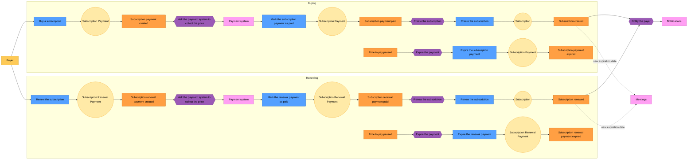
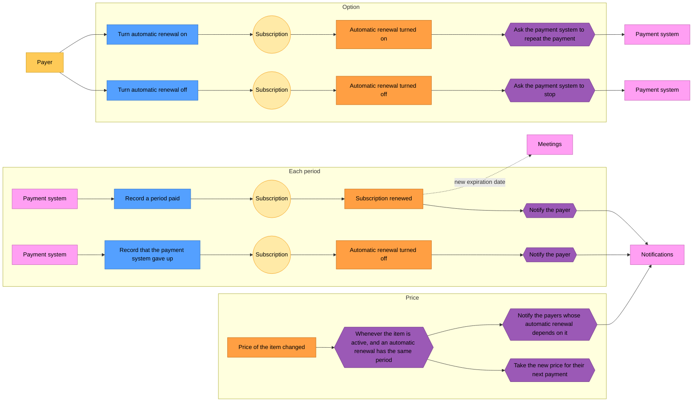
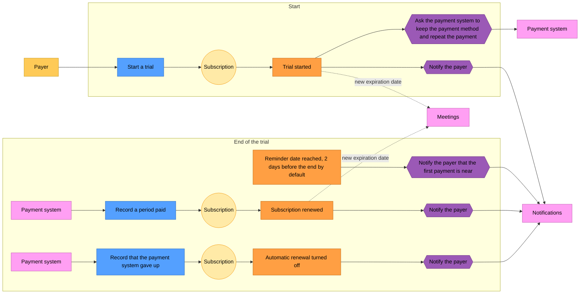
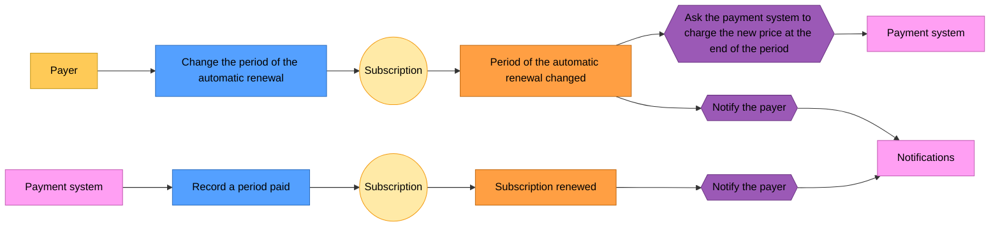
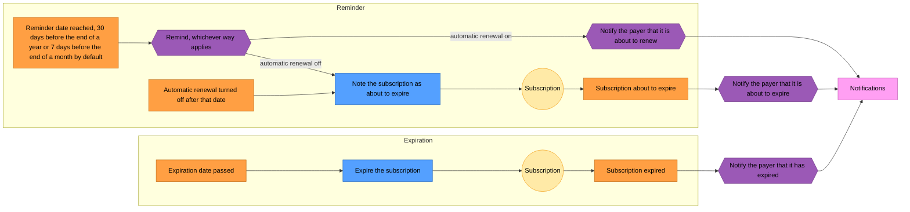

# Payments: event storming of subscriptions

Event storming lays out a process as a sequence of **commands** (what someone asks), **aggregates** (what decides), **events** (what happened) and **policies** (what the system does in reaction). The [conceptual model](subscriptions-conceptual-model.md) shows the structure; this page shows the behaviour. The rules are in [subscriptions](subscriptions.md).

## Buying and renewing

Blue is a command, pale yellow an aggregate, orange an event, purple a policy, darker yellow someone who asks for a command, pink an external system.

### Reading it

1. **Buying.** A payer without a subscription buys one. The price must be the active price of the list, and the payer must have no payment waiting. The command creates a subscription payment, which holds the period and the price.
2. **Collecting.** Creating the payment is not enough: a policy asks the [payment system](description.md#the-payment-system) to collect the price. Payments never takes the money itself.
3. **Paid.** The payment system's answer is the only thing that marks the payment as paid. That event, and not the command of the payer, is what creates the subscription, active, with an expiration date one period after the moment of payment.
4. **Expired.** When time passes without an answer, nobody asked: the payment expires, nothing is created, and the payer may start again.
5. **Renewing.** A payer with a subscription, active or expired, renews it by the same path, with a renewal payment and the same active price of the list. The paid event renews the subscription: the period adds up to the date when the subscription was still active, and starts at the payment otherwise.
6. **The expiration date.** Both a creation and a renewal bring a new expiration date, which [Meetings](../meetings/group-life-event-storming.md) needs to know (dotted arrow). The payer is also notified.

## Automatic renewal

Blue is a command, pale yellow an aggregate, orange an event, purple a policy, darker yellow someone who asks for a command, pink an external system.

### Reading it

1. **Turning it on.** The payer chooses a period and agrees to be charged again at the end of each period. The subscription keeps the period and the price, and the payment system is asked to repeat the payment.
2. **Turning it off.** The payer turns it off whenever they want, and the payment system is asked to stop. The subscription runs until its date.
3. **A period paid.** Nobody in Payments asks for the renewal: the payment system confirms a period paid, and the subscription is renewed exactly as by a manual renewal, with the same new expiration date and the same notification.
4. **Given up.** After its own retries, the payment system reports that it gives up, and the option is turned off, and a notification tells the payer. Between a first failure and that moment, Payments does nothing.
5. **The price.** When the price of an active item changes, every automatic renewal that depends on it, with the same period, takes the new price for its next payment, and a notification tells the payer. A trial not yet paid depends on the same item as any other automatic renewal. The payer who refuses turns the option off. A deactivation changes nothing.

## Trying

Blue is a command, pale yellow an aggregate, orange an event, purple a policy, darker yellow someone who asks for a command, pink an external system.

### Reading it

1. **Starting.** A payer who never held a subscription starts a trial. The command creates the subscription at once, active, expiring after the length of the trial, with automatic renewal on for the chosen period. No payment is created: nothing is charged yet. The payer saw the active price and agrees to be charged the price active at the end, being notified if it changes.
2. **The expiration date.** The creation brings an expiration date, which [Meetings](../meetings/group-life-event-storming.md) needs to know like any other, so the groups are covered during the trial.
3. **The end.** Nobody in Payments asks for the first payment: the payment system confirms a period paid, at the active price at that moment, and the subscription is renewed as by any automatic renewal.
4. **Not continuing.** The payer turns automatic renewal off, as in [automatic renewal](#automatic-renewal), and the subscription ends with the trial.

## Changing the period

Blue is a command, pale yellow an aggregate, orange an event, purple a policy, darker yellow someone who asks for a command, pink an external system.

### Reading it

1. **Asking.** The subscription must be active. It changes the period of the next payment and nothing else: its expiration date does not move.
2. **At the end of the period.** The payment system takes the new price and confirms a period paid. The subscription is renewed for the new period, which starts exactly at the old expiration date.
3. **No credit, no refund.** Neither is computed: the old period is not shortened and the new one is not started early.

## When a subscription ends

Blue is a command, pale yellow an aggregate, orange an event, purple a policy, pink an external system.

### Reading it

1. **The reminder date.** Time brings it, a configurable delay before the expiration date, which depends on the period in progress: 30 days for a year and 7 days for a month by default. Two cases: with automatic renewal off, the subscription is noted as about to expire, once for each expiration date, and the payer is notified; with it on, only a notification to the payer goes out, with the date and the price, and the subscription is not about to expire.
2. **Turned off late.** When automatic renewal is turned off after the reminder date has passed, it is noted as about to expire at once, since its moment is already behind.
3. **Expiring.** When the expiration date passes, the subscription expires, whatever the option, and the payer can renew it. This is the case when an automatic payment did not arrive in time.
4. **Notifying.** Payments notifies the payer of both facts, whether or not they own a group. Meetings needs neither: it decides from the expiration date whether a group is [covered](../meetings/group-life.md#covering-the-group).
