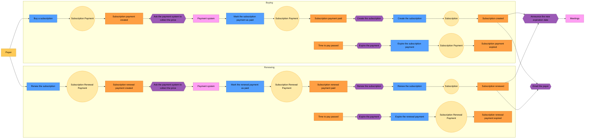
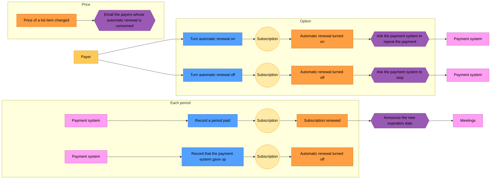
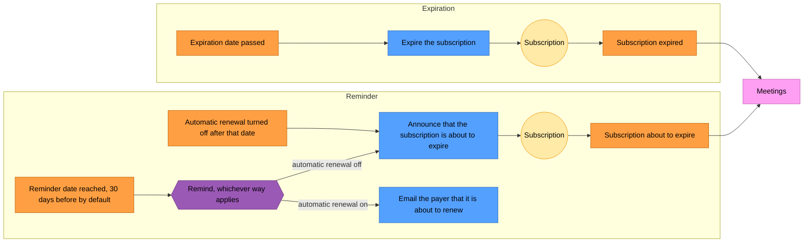

# Payments: event storming of subscriptions

Event storming lays out a process as a sequence of **commands** (what someone asks), **aggregates** (what decides), **events** (what happened) and **policies** (what the system does in reaction). The [conceptual model](subscriptions-conceptual-model.md) shows the structure; this page shows the behaviour. The rules are in [subscriptions](subscriptions.md).

## Buying and renewing

Blue is a command, pale yellow an aggregate, orange an event, purple a policy, darker yellow someone who asks for a command, pink an external system.

### Reading it

1. **Buying.** A payer without a subscription buys one. The price must be the active price of the list, and the payer must have no payment waiting. The command creates a subscription payment, which holds the period, the country and the price.
2. **Collecting.** Creating the payment is not enough: a policy asks the [payment system](description.md#the-payment-system) to collect the price. Payments never takes the money itself.
3. **Paid.** The payment system's answer is the only thing that marks the payment as paid. That event, and not the command of the payer, is what creates the subscription, active, with an expiration date one period after the moment of payment.
4. **Expired.** When time passes without an answer, nobody asked: the payment expires, nothing is created, and the payer may start again.
5. **Renewing.** A payer with a subscription, active or expired, renews it by the same path, with a renewal payment and the price of the renewal kind. The paid event renews the subscription: the period adds up to the date when the subscription was still active, and starts at the payment otherwise.
6. **The announcement.** Both a creation and a renewal bring a new expiration date, which Payments announces to the rest of the application. [Meetings](../meetings/group-life-event-storming.md) listens and records it. The payer also gets an email.

## Automatic renewal

Blue is a command, pale yellow an aggregate, orange an event, purple a policy, darker yellow someone who asks for a command, pink an external system.

### Reading it

1. **Turning it on.** The payer chooses a period and agrees to be charged again at the end of each period. The subscription keeps the period, the country and the price, and the payment system is asked to repeat the payment.
2. **Turning it off.** The payer turns it off whenever they want, and the payment system is asked to stop. The subscription runs until its date.
3. **A period paid.** Nobody in Payments asks for the renewal: the payment system announces a period paid, and the subscription is renewed exactly as by a manual renewal, with the same announcement and the same email.
4. **Given up.** After its own retries, the payment system announces that it gives up, and the option is turned off. Between a first failure and that moment, Payments does nothing.
5. **The price.** When a price of the list changes, an email goes to every payer whose automatic renewal depends on that price. The renewal keeps its fixed price until the next period, where the new one applies. The payer who refuses turns the option off.

## When a subscription ends

Blue is a command, pale yellow an aggregate, orange an event, purple a policy, pink an external system.

### Reading it

1. **The reminder date.** Time brings it, a configurable delay before the expiration date. Two cases: with automatic renewal off, the subscription announces that it is about to expire, once for each expiration date; with it on, only an email to the payer goes out, with the date and the price, and nothing is announced.
2. **Turned off late.** When automatic renewal is turned off after the reminder date has passed, the announcement is made at once, since its moment is already behind.
3. **Expiring.** When the expiration date passes, the subscription expires, whatever the option, and the payer can renew it. This is the case when an automatic payment did not arrive in time.
4. **What Meetings does.** Meetings listens to both announcements. It sends the reminder and the notice to the owner, and it decides from the date, not from these announcements, whether a group is [covered](../meetings/group-life.md#covering-the-group).
