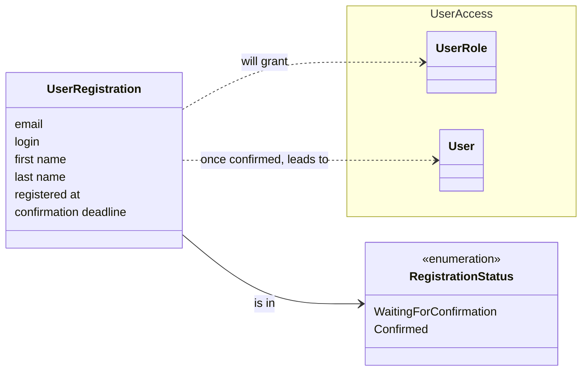

# Registrations: conceptual model

A conceptual model shows the things of the domain and how they relate, before any technical choice. Behaviour is in the [event storming](event-storming.md).

## Reading it

- **User Registration** is the only thing Registrations owns. It carries the email address, the moment it was made and the moment it stops being confirmable (48 hours after the latest link was sent). The login, the names and the password are part of it too; for an invitation they are filled in at confirmation, not before.
- **The role** it will grant is fixed when the registration is created: Member for someone who registers, Administrator for someone who is invited. It lives in [UserAccess](../useraccess/conceptual-model.md), and the registration only points at it.
- **Status** has two values. A registration that expires is not given a third status: it is deleted, and "expired" is simply a deadline in the past.
- **User** is created in UserAccess by a confirmed registration, and keeps no other tie with it.

## The same person, seen from several contexts

Someone who registers as a member will be a different thing in each context, and Registrations knows none of them:

- in UserAccess, a **User**,
- in Meetings, a **Member**,
- in Payments, a **Payer**.

They share the identity given at registration, and nothing else. An invited administrator is a **User** only.
