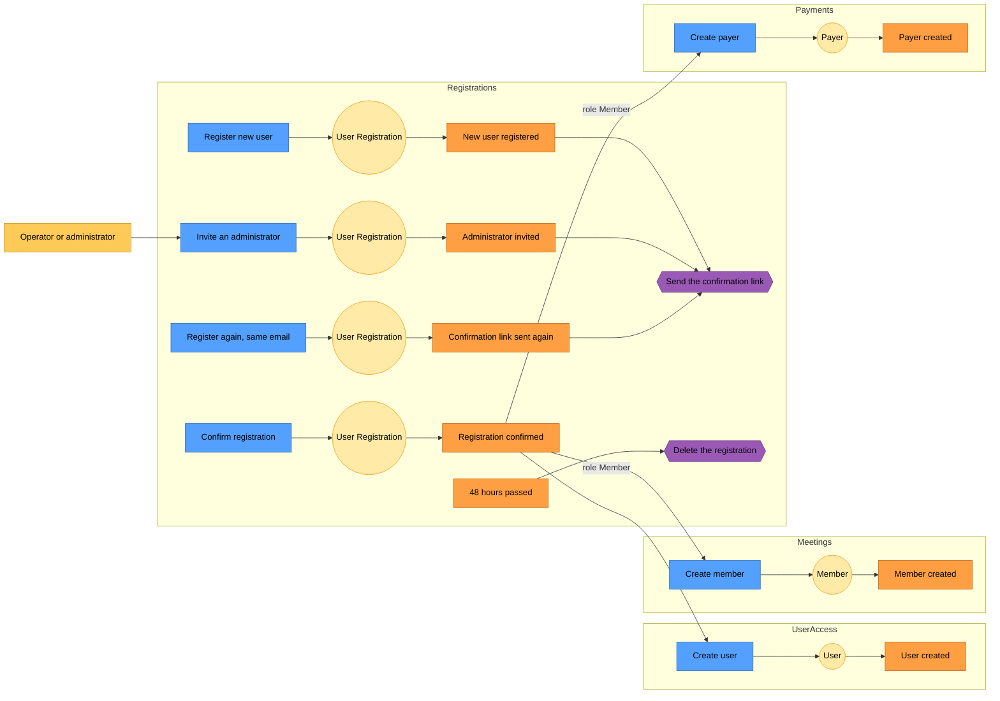

# Registrations: event storming

Event storming lays out a process as a sequence of **commands** (what someone asks), **aggregates** (what decides), **events** (what happened) and **policies** (what the system does in reaction). The [conceptual model](conceptual-model.md) shows the structure; this page shows the behaviour.

Blue is a command, pale yellow an aggregate, orange an event, purple a policy, darker yellow someone who asks for a command.

## Reading it

1. **Registering.** The person registers. A registration is created for the Member role, and the confirmation link goes out as a reaction to the event, not as part of the command.
2. **Inviting.** The operator or an administrator invites someone. The registration is created for the Administrator role, and the same policy sends the link.
3. **Registering again.** Same aggregate, same registration: a new link is sent and the deadline starts again. When the address belongs to an existing user, nothing here happens: an email says so instead, and no registration is touched.
4. **Confirming.** The registration is confirmed, if it is still waiting and before its deadline. For an invitation, this is where the person gives their login, password and names. This is the only event the rest of the system listens to.
5. **After the confirmation.** The rest of the system creates what it needs, in reaction to the same event: UserAccess always creates a user, with the role of the registration. Meetings and Payments create a member and a payer only for the Member role, and they do not wait for each other.
6. **Expiring.** When 48 hours pass without confirmation, the registration is deleted. Nobody asked for it: it is time that triggers it.
