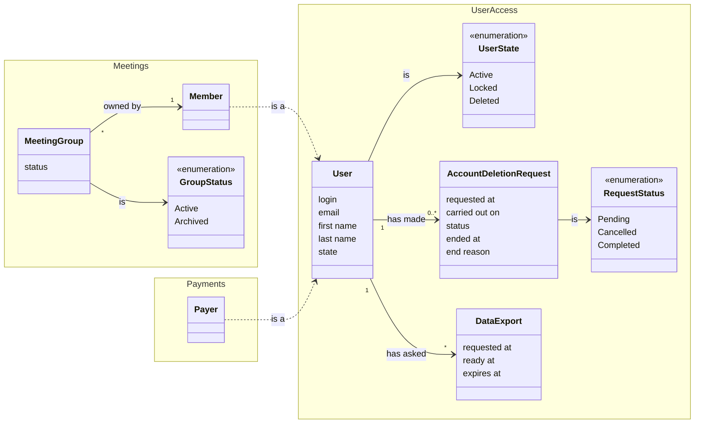

# Deleting an account: conceptual model

The things of the domain and how they relate, before any technical choice. The rules are described in [deleting an account](account-deletion.md); the behaviour is in the [event storming](account-deletion-event-storming.md).

## Reading it

- **Account Deletion Request** is the only thing that decides the deletion. It is created when the member requests it, with the day it will be carried out, which is the end of the grace period. It is **Pending** until it ends: **Cancelled** by the member, or by the application when something stands in the way at the end, with the reason, or **Completed** when the deletion is carried out. A user has one pending request at most, and as many ended ones as they like: they are kept, without anything that identifies the person, as the trace that a deletion happened.
- **User state** says what the user can do. **Active** is the ordinary case. **Locked** is the state of a pending request: the user reads what they read before and changes nothing, except cancelling the request, exporting their data and marking their notifications as read. **Deleted** is the end: the login, the email address, the names and the password are erased and the user can no longer sign in. Only the identifier remains.
- **Data Export** is what a member asks to receive. It is ready after a while, and expires after another. Its content is not part of the model: it is what each context holds about the person on the day.
- **Member** and **Payer** are the same person seen from Meetings and Payments. When the user is deleted, both become anonymous: the others know them as a **deleted member**, and what they hold keeps the identifier alone.
- **Meeting Group** has a status. **Archived** is final: the group is frozen, with its past, its comments and its anonymous owner. A group is archived only when its owner is deleted and the group was not handed over. Its owner stays its owner, shown as a deleted member.

## What is not in the model

- No list of the open items: they are read from Meetings and Payments at the request and again at its end, they are not kept.
- No choice kept for a group: an owner cannot leave, so a group owned at the end is archived, not left.
- No state between Pending and Completed: the final check of the open items and the carrying out form **one decision**, with nothing able to stand in the way between them. When something stands in the way at that moment, the request ends Cancelled. The parts of the carrying out are then done by each context on its own.
- No undo: Completed and Deleted are final.
- No request for an administrator: an administrator is deleted by another, at once, without a request.
- No copy of the data to erase: the export is a snapshot that expires, and is the only copy the application keeps.
