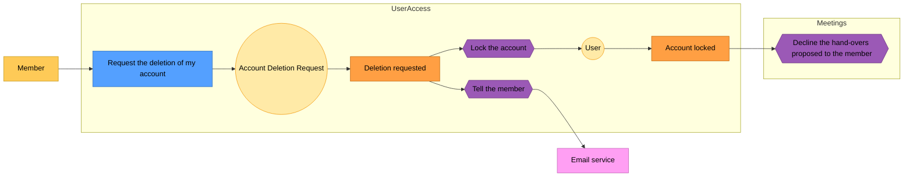
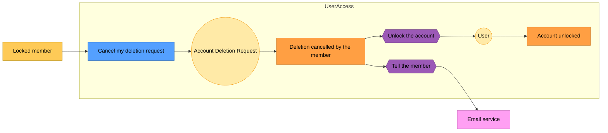
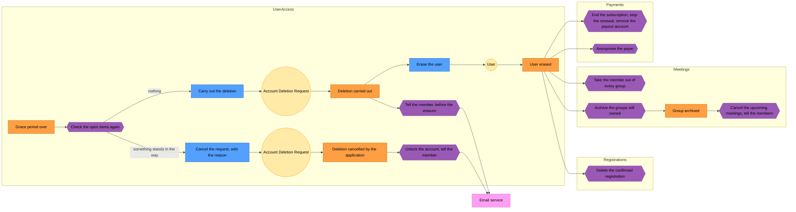
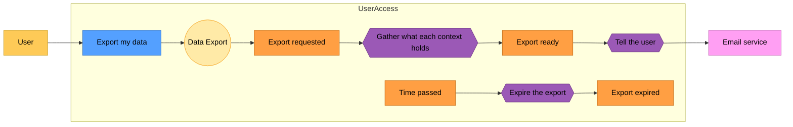
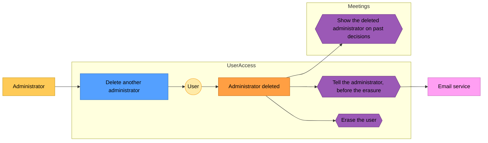
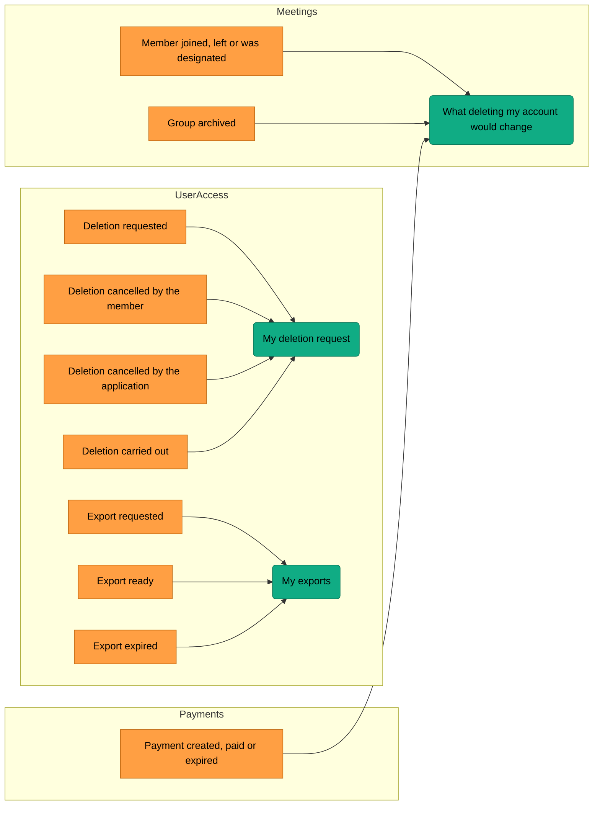

# Deleting an account: event storming

Event storming lays out a process as a sequence of **commands** (what someone asks), **aggregates** (what decides), **events** (what happened) and **policies** (what the system does in reaction). The [conceptual model](account-deletion-conceptual-model.md) shows the structure; this page shows the behaviour described in [deleting an account](account-deletion.md). It has five parts: requesting, cancelling, carrying out, exporting, and deleting an administrator, then the reading.

## Requesting

Blue is a command, pale yellow an aggregate, orange an event, purple a policy, darker yellow someone who asks for a command, pink an external system.

1. **Refusals.** The request is refused when the user is an administrator, when a request of theirs is already pending, or when an [open item](account-deletion.md#what-stands-in-the-way) stands in the way: a group they own that is under hand-over, a last host of an upcoming meeting, a payment that waits, a proposal that is pending. The check and the request are one decision: if something stands in the way at the same moment, only one of the two succeeds.
2. **The request** remembers when it was made and the day it will be carried out, the end of the grace period.
3. **Locking.** The account is locked as soon as the request exists. Meetings needs to know it, to decline a hand-over that was proposed to the member, which ends it as for a candidate that left.
4. **Email.** The member is told the date and what will happen.

## Cancelling

Blue is a command, pale yellow an aggregate, orange an event, purple a policy, darker yellow someone who asks for a command, pink an external system.

1. **Only while pending.** Nothing can be cancelled after the grace period is over and the deletion is carried out.
2. **Unlocking.** The account is as it was, except for the hand-overs that were declined: they are not restored, the owner proposes again.

## Carrying out

Blue is a command, pale yellow an aggregate, orange an event, purple a policy, pink an external system.

1. **The check, again.** The same rules as at the request, on the open items at that moment. If they do not hold, nothing is erased, the request is cancelled with the reason, and the account is unlocked.
2. **Erasing.** The login, the email address, the names and the password are erased, and the user is deleted. The member is told first, at the address that the erasure then takes away.
3. **Registrations.** The confirmed registration of the user is deleted, which frees the login and the email address.
4. **Meetings.** The member leaves every group as if they left it themselves. A group they still own is archived, with its upcoming meetings cancelled. The comments, likes and decisions of the member stay, with the deleted member in place of the person.
5. **Payments.** The subscription ends with no refund and no further renewal, the payout account is removed, and the payer is anonymised. The payments are kept without an identity.
6. **Independent parts.** The three contexts act on their own, each when it knows. None waits for the others, and none can undo what it did.

## Exporting

Blue is a command, pale yellow an aggregate, orange an event, purple a policy, darker yellow someone who asks for a command, pink an external system.

1. **Who.** Any user, locked or not, an administrator included: their export holds what UserAccess knows of them.
2. **Gathering.** Each context gives what it holds about the person. The export is ready when all have.
3. **Expiring.** After a limited time the export is no longer available, and the user asks again if they need it.

## Deleting an administrator

Blue is a command, pale yellow an aggregate, orange an event, purple a policy, darker yellow someone who asks for a command, pink an external system.

1. **Refusals.** Nobody deletes themselves, and the target must be an administrator. The command is refused when it would leave no administrator, whichever way two deletions overlap.
2. **At once.** There is no request, no grace period and no lock: the administrator is neither a member nor a payer.
3. **Past decisions.** The proposals the administrator accepted or rejected keep who, when and why, with the deleted administrator in place of the person.

## Reading

Orange is an event, green a read model.

1. **My deletion request.** It follows the request until it ends.
2. **My exports.** It follows the exports of the user.
3. **What deleting my account would change.** It brings together what Meetings and Payments hold about the member: the groups they own, the meetings where they are the last host, the proposals pending and the payments that wait. It is read on demand, and checked again by the commands, never trusted from the view alone.
4. **Who sees what.** Only the member reads these views, as listed in [deleting an account](account-deletion.md#reading).
