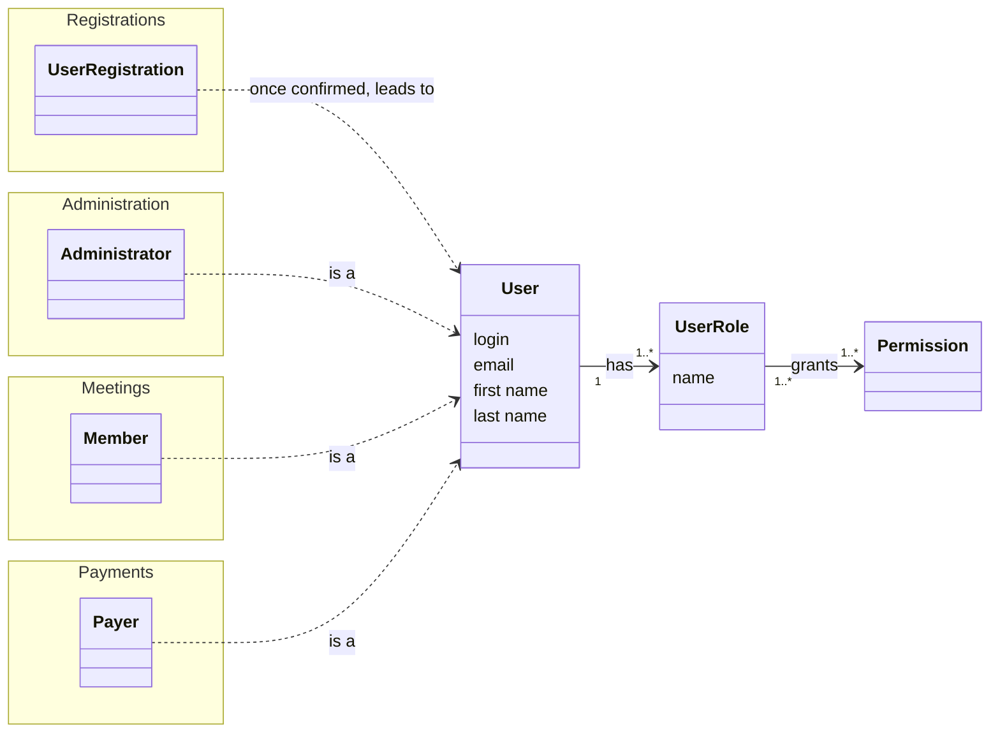

# UserAccess: conceptual model

The things of the domain and how they relate. The user's creation is shown in the [event storming of the registration](../registrations/event-storming.md), since UserAccess has no process of its own to draw.

## Reading it

- **User** carries what the person gave at sign-up. It always has at least one role.
- **User Role** is a named group of permissions. There are two, Member and Administrator.
- **Permission** is the smallest unit: one action that can be allowed.
- The dotted arrows are the same person seen from other contexts. UserAccess does not know them: they know the user.
