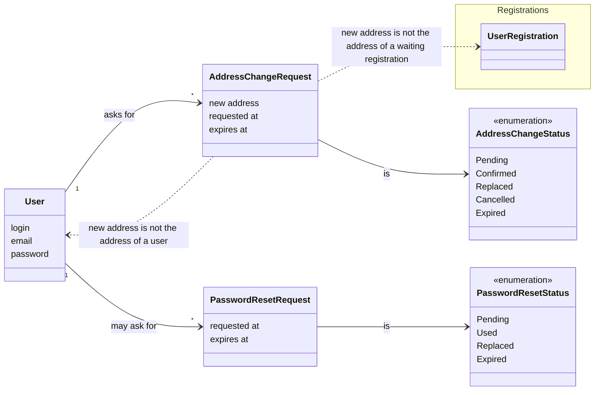

# UserAccess: conceptual model of profile management

The things of the domain and how they relate, before any technical choice. The rules are described in [profile management](profile-management.md); the behaviour is in the [event storming](profile-management-event-storming.md).

## Reading it

- **Address Change Request** is an aggregate. It is created pending, with the new address and its deadline, 48 hours later. It ends **Confirmed**, **Replaced** by a newer request of the same user, **Cancelled** when the user requests the deletion of their account, or **Expired**. A user has at most one pending request. It is created only when the new address is free; otherwise the answer is the same but nothing is created.
- **Password Reset Request** is an aggregate. It is created pending, with its deadline, 1 hour later. It ends **Used**, **Replaced** by a newer request, or **Expired**. A user has at most one pending request.
- **User** holds the current address and the password. Confirming an address change or resetting a password changes the user. Notifications uses the current address, which is the old one until a change is confirmed.
- The password itself is never kept in a request: the person chooses it when following a reset link.

## Rules that cross aggregates

- **One owner for an address.** The address of a request must belong to no user and to no registration waiting for confirmation, when the request is made and again when it is confirmed. The rule involves every user and every registration, so a domain service checks it, reading what is stored. It is absolute: when two requests for the same address are confirmed at the same moment, or one of them and a registration with that address, only one succeeds.
- **One pending request for each user.** A new address change request or password reset request replaces the pending one of its kind. The rule is absolute: when two requests of a user arrive at the same moment, only one stays pending.
- **A link works once.** A confirmation link or a reset link followed twice at the same moment gives only one success.

## What is not in the model

- No login and no names to change.
- No history of the addresses a user had.
- No second factor and no choice of sessions to end.
- No cancel link in the message to the old address.
