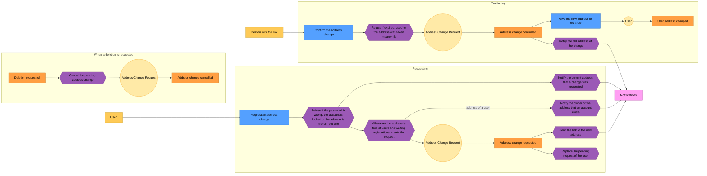
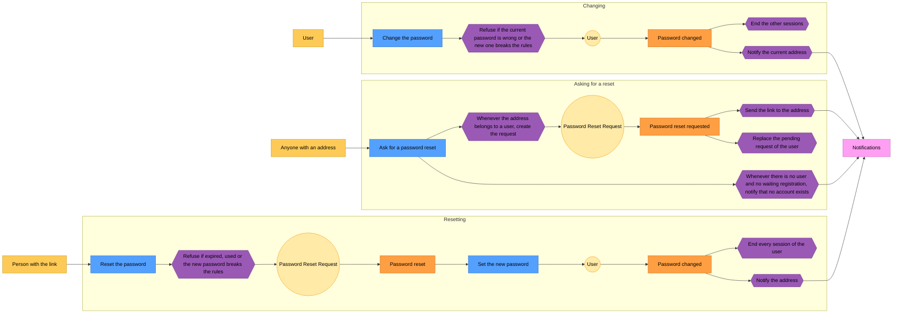

# UserAccess: event storming of profile management

Event storming lays out a process as a sequence of **commands** (what someone asks), **aggregates** (what decides), **events** (what happened) and **policies** (what the system does in reaction). The [conceptual model](profile-management-conceptual-model.md) shows the structure; this page shows the behaviour. The rules are in [profile management](profile-management.md).

## Changing the address

Blue is a command, pale yellow an aggregate, orange an event, purple a policy, darker yellow someone who asks for a command, pink another context.

1. **Requesting.** The refusals come first. Then the same answer goes back whatever the address. When it is free of users and waiting registrations, the request is created and the link goes to the new address; when it belongs to a user, nothing is created and its owner is told that an account exists; when it belongs to a waiting registration, nothing more happens. In every case the current address is told that a change was requested.
2. **One at a time.** A new request replaces the pending one, whose link stops working.
3. **Confirming.** The link works once and before its deadline. The address is checked again: if it was taken meanwhile, the link is refused as expired or invalid. Then the user takes the new address, the old one is free, and the old address is told. Sessions go on.
4. **Deleting.** When the user requests the deletion of their account, a pending request is cancelled.

## Changing and resetting the password

Blue is a command, pale yellow an aggregate, orange an event, purple a policy, darker yellow someone who asks for a command, pink another context.

1. **Changing.** The current password is checked, and the new one must follow the rules. The other sessions end, the current one goes on, and the current address is told. A locked account may do it.
2. **Asking.** The answer is the same sentence and takes the same time whatever the address. For a user, a request is created, replacing the pending one, and the link goes to the address; with no user and no waiting registration, a message tells the address that no account exists; for a waiting registration, nothing more happens.
3. **Resetting.** The link works once and for 1 hour. Following it, the person chooses a password that follows the rules. Every session of the user ends, and the address is told that the password changed. A locked account and an administrator can reset.
